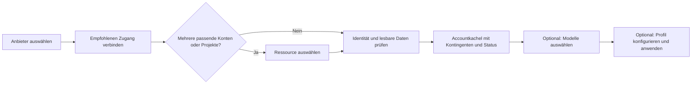

# Account verbinden: weniger Eingaben, getrennte Fähigkeiten

Stand 24.10.2026, Architekturentwurf auf lain `5dc916f`. Nutzerauftrag: Account
Connect grundsätzlich überarbeiten und für alle Anbieter prüfen, ob eine
Anmeldung Kontingente, Inferenz oder automatisch einen API-Key erschließen kann.
Sechs GPT-6.1-Sol-Worker haben die abgeschlossene
[Quota-/Auth-Recherche](quota-auth-research-2026-10-24.md) vertieft: **25 Anbieter,
35 Produkt-/Verbindungsvarianten**, sechzehn Einzelartefakte mit konkreten Abläufen.
Der Umfang umfasst auch Codex, Command Code, Kimi und Z.ai als vorhandene
Referenzanschlüsse. Dies ist ein
Bedienungs- und Integrationsvorschlag, noch keine Produktimplementierung.

## Empfehlung

**Anbieter auswählen → anmelden → Account mit seinen verfügbaren Fähigkeiten
anzeigen.** Modellwahl und Routing folgen als eigene, optionale Aufgabe.
Der Nutzer soll keinen künstlichen Accounttarif wählen müssen, nur weil lain
bisher eine einzelne Modellroute vorbereitet hat.

Bevorzugt wird der jeweils einfachste belegte Zugang: eigener öffentlicher
Browserlogin, offizielle CLI-Anmeldung mit gezielter Übergabe, bewusst
eingerichtete Consoleanmeldung oder als Fallback ein lokal eingegebener Key.
OAuth ist dabei ein Mittel für weniger Einrichtungsschritte. Es beweist weder
eine Quotaquelle noch ein weitergehendes Leserecht. Manche Provider stellen
nach dem Login einen API-Key aus; der Nutzer muss ihn trotzdem nicht kopieren.

Bestätigte Anforderungen bleiben: Accounts als Startseite; kurze Namen;
vorhandene Accounts/History bewahren; Monitor ohne Proxy zunächst für Kontingente
und Resets; zusätzliche Modelle ohne erneute Keyeingabe; eigene Namen erhalten;
keine automatischen Käufe oder kostenpflichtigen Fallbacks. Der Nutzer möchte
Browseranmeldung bevorzugen, soweit sie den Zugang tatsächlich vereinfacht.
Die folgenden Interaktions- und Vertragsdetails sind noch Empfehlungen.

## Was der aktuelle Code vermischt

- [ProviderCatalogRegistry](../src/Lain.Host/Providers/ProviderCatalogRegistry.cs)
  erzeugt `Connections` aus Modellrouten, Endpoint und Protokoll. Die Validierung
  fordert Modelltemplates und Tarif-IDs und gleicht beides gegeneinander ab.
- [AccountService.AddApi](../src/Lain.Host/Accounts/AccountService.cs) braucht
  auch beim Speichern ohne ausgewählte Modelle einen Tarif und mindestens ein
  dadurch erlaubtes Modelltemplate. „Noch keine Modelle auswählen“ löst diese
  interne Abhängigkeit nicht.
- [Die UI](../src/Lain.Desktop/MainWindow.Providers.cs) zeigt diesen Tarif als
  Pflichtfeld, setzt auch bei nur einer Wahl keinen ausgewählten Wert und
  erwartet einen geheimen API-Key. Die CLI verwendet denselben Katalog.
- `MonitorAccessService` besitzt schon einen privaten Monitorcredential-Speicher,
  verlangt aber einen bestehenden API-Key-Account; `HostQuotaSource` verlangt
  dessen Inferenzsecret. Ein unabhängiger Monitor ist damit noch nicht möglich.
- `LoginOperationService` besitzt bereits zustandsbehaftete, abbrechbare
  Loginoperationen, aber
  Provider statt konkreter Methode/Zweck/Zielaccount als Startkontext. Neue
  Loginwege gehören an diese vorhandene Schiene, nicht in einen zweiten Wizard.

Kilo macht den Fehler sichtbar: `free-models` beschreibt unsere einzige
vorbereitete Modellroute. Es ist kein erkannter Kilo-Tarif. Der vorhandene Key
könnte Wallet und persönlichen Pass lesen; in lain fehlt der Reader. Ein Login-
Umbau allein behebt diesen fehlenden Reader nicht.

## Vorgeschlagener Ablauf

### Vor der Anmeldung

Ein klarer Hauptbutton, etwa **„Mit Kilo verbinden“**, **„Mit Google anmelden“**
oder **„Über Requesty CLI anmelden“**. Darunter höchstens eine kurze Erklärung,
was diese Verbindung ermöglicht. Unterstützte Alternativen wie **„API-Key
verwenden“** oder **„Vorhandenen Zugang übernehmen“** stehen unter „Andere
Verbindungsmethode“. Kein OAuthbutton, dessen Callback/Lifecycle noch gar nicht
implementiert und qualifiziert ist.

Der Zweck ergibt sich möglichst aus dem Einstieg: In der Monitoransicht genügt
Kontingentzugriff; „Für Modelle verbinden“ verlangt zusätzlich Inferenz. Wo sich
dadurch Scopes oder erzeugte Credentials wesentlich unterscheiden, werden die
Optionen **„Kontingente anzeigen“** und **„Auch Modelle verwenden“** vor dem
Anbieterconsent sichtbar. Es gibt keinen obligatorischen Zweckfragebogen für
Anbieter, deren gleicher Key beide Fähigkeiten ohnehin gewährt.

Ein nur lesender Connect erzeugt keinen vermeidbaren zusätzlichen Inferenzkey.
Wenn der Anbieter einen Key als einzigen Zugang auch zum Monitoring ausgibt,
ist dieser Bestandteil des erklärten Connect-Vorgangs. Das aktiviert noch
keine Modellroute und sendet keinen Modellrequest.

### Während der Anmeldung

Systembrowser bei öffentlichen OAuth-/Keybootstrap-Flows; bei CLI-Delegation
ein privates lain-Profil beziehungsweise ein isoliertes Konfigurationsverzeichnis.
Der Nutzer sieht „Im Browser fortfahren“, Abbrechen und eine Wiederöffnen-Aktion.
Eine eigene Appregistrierung und Client-ID gehören zur Maintainerarbeit, nicht
in das normale Nutzerformular.

Wenn der Anbieter verifizierte Account-, Organisations- oder Projektlisten
liefert, übernimmt lain eine eindeutige Ressource und zeigt sie im Ergebnis.
Bei mehreren passenden Ressourcen wählt der Nutzer eine aus. Beim Reconnect
bleibt der bestehende Scope gebunden; kein stiller Wechsel zum Browserdefault.
Kann eine Region oder Produktvariante nicht erkannt werden und ändert sie Host,
Credential oder Abrechnung, bleibt genau diese Auswahl erforderlich. Ein
Loginname oder die E-Mail-Adresse ersetzt keine belastbare Ressourcenidentität.

### Nach der Anmeldung

Der Host liest die minimale belegte Identitäts-/Quotaquelle und speichert die
bestätigten Fähigkeiten am selben Account. Ein Modelllisten-GET kann Metadaten
prüfen; er beweist keine erfolgreiche Inferenz. Es wird keine Inferenz zur
Einrichtung oder zum Quota-Refresh erfunden.

Die Kachel zeigt sofort verfügbare Werte. Beispiel Kilo: **Kontoguthaben in USD**,
gegebenenfalls Passstatus und nächste belegte Gutschrift. Geldsaldo ohne
Nenner bekommt keinen Prozentbalken. Verbleibende Plananteile werden nur aus
passenden echten Feldern berechnet. „Anmeldung erfolgreich“ darf nicht wie
„alle Kontingente verfügbar“ aussehen.

Bei Teilzugriff bleibt der funktionierende Teil nutzbar: beispielsweise
„Modelle verbunden · Kontingente: Leserechte ergänzen“. Abgelaufene oder fehlende
Quellen erscheinen als konkrete lokale Aktion, nicht als wiederholte globale
Warnung. Letzte erfolgreiche Werte bleiben mit Alter erhalten. Nur technische
Details zeigen Credentialart, Scope und Quellenqualifikation.

**„Modelle auswählen“** ist anschließend optional. Mehrfachauswahl, Freefilter,
Routenfreigabe und Profilanwendung gehören dorthin. Ein vorhandenes Guthaben
oder Abo erlaubt keine automatische bezahlte Modellwahl. Das bloße Verbinden
startet keinen Proxy, wendet kein Profil an und benötigt im Monitormodus keinen
installierten Core.

## Anbieter: empfohlener Connect nach Umsetzung und Qualifikation

Die Tabelle beschreibt das Ziel und dessen belegte Grundlage. Ein vorhandener
Herstellerflow ist nicht automatisch schon in lain verfügbar. Die Einzelberichte
enthalten Benutzerhandlungen, Credentialtypen, tatsächliche Rechte, Reconnect,
Maintaineraufgaben und Fallbacks. Gleicher Provider bedeutet nicht gleicher
Produktscope.

| Anbieter | Empfohlener Einstieg | Danach ohne weitere Keyeingabe möglich | Konkrete verbleibende Grenze |
| --- | --- | --- | --- |
| [Alibaba](account-connect-research/alibaba-nebius-inception.md) | Offizielle CLI-Browseranmeldung im eigenen `BAILIAN_CONFIG_DIR` | Gewöhnlicher Inferenzkey plus Console-Usage/Trialrest; Coding-Plan-Monitor separat | Beijing/Singapore-Scope, gepinnter Dateiadapter und Reads prüfen; Sessionerneuerung ohne stilles Nachfordern von AK/SK. |
| [Cloudflare](account-connect-research/groq-mistral-google-cloudflare.md) | Eigener öffentlicher OAuth-Client, direktes Token | Inferenz und optionale Neuron-Analytics als gemeinsames Ziel | Scopes, konkreter Transport, Accountdiscovery, Dataset und Sampling qualifizieren. Kein eigener Deviceflow und keine automatische Tokenprovisionierung. |
| [Cohere](account-connect-research/samba-upstage-cohere.md) | Proprietäres Browser-Pairing oder eigene Session als Kandidat | Consoleusage plus gezielte Übernahme eines passenden Keys | Pairingrechte/Lifecycle offen. Evaluation: vorhandenen passenden Key übernehmen; Trial-Neuanlage ist kein belegter Evaluationersatz. Production separat. |
| [Fireworks](account-connect-research/mimo-nvidia-fireworks.md) | Offizielle `firectl`-Browseranmeldung, danach benannter Nutzer-Key | Inferenz und vorhandener Quota-Reader mit erkanntem Account | Signin-Profilisolierung und genaue private JSON-Ausgabe/Produkttyp qualifizieren. Bestehenden Key zuerst verwenden, keinen automatisch ersetzen. |
| [Gemini](account-connect-research/groq-mistral-google-cloudflare.md) | Eigener Google-Login plus bestehendes Projekt | Direktes OAuth für Inferenz und Projektmonitor als Ziel; vorhandenen Key alternativ behalten | Genaue OAuth-Akzeptanz des Inferenztransports, Rechte und Quotaserienjoin prüfen. Keine Key-/Serviceaccountanlage als Standard. |
| [Groq](account-connect-research/groq-mistral-google-cloudflare.md) | Ein vorhandener Projektkey | Passive Grenzen nach normalen Requests über lain, Enterprise-Metrics optional | Kein qualifizierter allgemeiner Browserbootstrap oder Free-/Developer-Standalone-Monitor. Kein zusätzlicher Key für Header. |
| [Inception](account-connect-research/alibaba-nebius-inception.md) | Ein Key über direkten Anbieterlink | Inferenz; lokal beobachtete Usage | Öffentlicher Loginbootstrap und Kontorestquelle weiter offen. Kein Trial/PAYG-Pflichtfeld ohne Authwirkung. |
| [Kilo](account-connect-research/kilo-opencode-requesty-openrouter.md) | Bestehenden Key sofort für Wallet/Pass nutzen; Device-Login als Komfortziel | Wallet und persönlicher Pass mit demselben Zugang | Eigene Device-Nutzung oder unterstützte CLI-Übergabe qualifizieren. „Free“ zur Modellwahl verschieben, nicht als Accounttarif verlangen. |
| [Mistral](account-connect-research/groq-mistral-google-cloudflare.md) | Studio-Key; Vibe-Browserbootstrap nach Produktscopeprüfung | Passender Inferenzkey ohne Kopieren als Ziel; Enterprise-Adminmonitor getrennt | Vibe-Key ist kein Admin-Key. Adminmonitor auch eigenständig ohne Inferenzkey ermöglichen; Headerwiderspruch klären. |
| [Nebius](account-connect-research/alibaba-nebius-inception.md) | Ein Token-Factory-Projektkey | Inferenz und passive RPM/TPM | Cloud-PKCE → Serviceaccountkey ist kein einfacher persönlicher Login. Serverlessbalance bleibt offen; keine zusätzlichen IDs für Header verlangen. |
| [NVIDIA Build](account-connect-research/mimo-nvidia-fireworks.md) | Passenden Build-Key einmal übernehmen | Inferenzcredential | Kein geeigneter eigener OAuth-/Kontomonitor qualifiziert. Gezielter Public-Endpoint-Keyweg statt NGC-/Enterpriseumweg. |
| [OpenCode](account-connect-research/kilo-opencode-requesty-openrouter.md) | Workspace-Key; zusätzlich öffentliches MCP-OAuth untersuchen | Go/Plus/PAYG-Inferenz; MCP-Monitor als Kandidat | Konkrete Quota-Readtools fehlen. CLIexport mit rotierenden Tokens ist keine sichere automatische Refreshübergabe. |
| [OpenRouter](account-connect-research/kilo-opencode-requesty-openrouter.md) | Eigener öffentlicher PKCE-Login | Inferenzkey und eigene Key-/Member-/Workspacelimits | Hostflow fehlt. Accountcredits haben separat dokumentierte Managementberechtigung. Keine Client-ID-Eingabe für Nutzer. |
| [Poe](account-connect-research/xai-stepfun-poe-synthetic.md) | Eigener öffentlicher PKCE-Login | Inferenz und Restpunkte mit ausgegebenem Key | Maintainerclient/Produktionscallback und Hostverdrahtung; Punkte sind kein belegtes Monatslimit/Reset. |
| [Requesty](account-connect-research/kilo-opencode-requesty-openrouter.md) | Offizielle CLI-Anmeldung in benanntem Profil | Inferenz und Self-Keybudget/-Usage; privater `auth token`-Helper belegt | CLI-Profil-/Prozessintegration prüfen. Organisationsbalance benötigt gesonderte Rechte; eigener nativer OAuthclient später. |
| [SambaNova](account-connect-research/samba-upstage-cohere.md) | Eigene Consoleanmeldung mit bewusstem Keybootstrap als Kandidat | Session für Credits/Usage; neuer benannter Inferenzkey privat übernehmbar | Sessionrückweg/CSRF und Drittclientintegration qualifizieren. Keyresponse nun belegt; reine Nutzung führt keine Keyoperation aus. |
| [StepFun](account-connect-research/xai-stepfun-poe-synthetic.md) | PAYG-Key; Step Plan separat mit Herstellerlogin als Ziel | Persönliche PAYG-Balance; Planusage laut offiziellem Vertrag mit Login-Key | Plan-Drittclientweg und Backendrollout ungeprüft; Regions-/Produktgrenzen erhalten. |
| [Synthetic](account-connect-research/xai-stepfun-poe-synthetic.md) | Ein API-Key | Inferenz und Aboquota automatisch | Aktuelles Schema ergänzen; kein weiterer Monitorkey. PAYG-Geldsaldo ist durch die Aboquota nicht abgedeckt. |
| [Upstage](account-connect-research/samba-upstage-cohere.md) | Eigene Consoleanmeldung, Orgwahl nur bei Mehrdeutigkeit | Session für Spend/Credits; benannter Key privat erzeugbar | Session-/BFF-/Drittclientvertrag qualifizieren. Create-Response nun belegt; Monitor-only weder Create noch Reveal. |
| [xAI API](account-connect-research/xai-stepfun-poe-synthetic.md) | Inferenzkey; optional Managementzugang am selben Account | Team über offizielles `/v1/api-key` erkennen; Billing bei passenden Readrechten | Kein Consumer-/Grok-Build-Login als Ersatz. Reiner Teammonitor benötigt keinen Inferenzkey. |
| [MiMo](account-connect-research/mimo-nvidia-fireworks.md) | Offizielle CLI für Inferenz; eigene Consolesitzung als gemeinsames Connectziel | Inferenzkey und Sessionquota als zwei Fähigkeiten nach einer Anmeldung | Gemeinsamer Browserkontext und eigener Authorizervertrag offen; Team-Keybootstrap separat. CLI allein überträgt keine Monitorsession. |

Für **Requesty** ist der neue Fund besonders praktisch: Der Hersteller stellt
`auth token --profile …` ausdrücklich als Integrationshelper bereit. Bei
**Alibaba** ermöglicht ein eigenes Configverzeichnis die Trennung vom normalen
CLIprofil; `config show` maskiert Secrets, weshalb der Zugriff auf das eigens
erstellte Profilformat eine zu pinnende Integrationsabhängigkeit bleibt.
Bei **xAI** entfällt die manuelle Team-ID, soweit der offizielle Keymetadatenread
sie bestätigt. Diese Verbesserungen verlangen keine neue allgemeine Formseite.

Die vier bestehenden Referenzanschlüsse gehören in denselben Chooser; ihr
funktionierender Zugang bleibt erhalten:

| Anbieter | Bestehenden Weg erhalten | Komfortziel und verbleibende Grenze |
| --- | --- | --- |
| [Codex](account-connect-research/reference-codex-commandcode.md) | Bereits implementierter eigener Browserlogin; aktueller Owned-Access-Token für Quota. Externe Snapshots getrennt, ohne Refresh. | Keine zweite Credentialabfrage. Heutiger Refresh hängt an aktiven Corerouten; unabhängiger Monitor braucht einen eigenen qualifizierten Lifecycle. Offizielles isoliertes app-server-Reporting ist ein Kandidat. Neue SIWC-OSS-Preview ist kein belegter Ersatz für dieselbe Quotaquelle. |
| [Command Code](account-connect-research/reference-codex-commandcode.md) | Derselbe vorhandene Key liefert Inferenz und den bestehenden Alpha-Quota-Reader. | Offizielles `cmd login` öffnet Browser und speichert einen Key. Gezielte Übernahme/Profilisolierung in lain qualifizieren; keine komplette fremde Authcacheübernahme. Erfolgreicher Login allein beweist nicht den planabhängigen Provider-API-Zugang. |
| [Kimi Code](account-connect-research/reference-kimi-zai.md) | Vorhandener Coding-Key liest `/usages` ohne Zusatzlogin. Moonshot-Plattformkeys sind ein anderes Produkt. | Offizieller Device-Login und gleicher OAuthzugang für Modelle/Usage im Herstellerclient belegt. Direkter lain-Transport beziehungsweise delegierter lokaler CLI-Usagezugang noch prüfen; der offizielle Agentserver ist kein beliebiger OpenAI-Proxy. |
| [Z.ai / GLM Coding](account-connect-research/reference-kimi-zai.md) | Vorhandener internationaler Key liest Quota direkt; keine zusätzliche Anmeldung erforderlich. | Offizielles ZCode belegt Browserlogin → Businesszugang → Projektkey-ID → kurzlebiger Zugriffstoken für Modelle/Quota. Eigene Clientannahme und Lifecycle offen; generischer Resolver darf im reinen Monitor nicht still einen Keydatensatz anlegen. Team/CN getrennt prüfen. |

Insbesondere **Kimi und Z.ai haben konkrete offizielle Loginimplementierungen**,
die in einer oberflächlichen API-Key-Dokumentationssuche leicht fehlen. Ihre
Übernahme benötigt jeweils einen durchgängigen, unterstützten Connector;
bestehende Keys und funktionierende Quotaabfragen werden dafür nicht ersetzt.

## Gemeinsamer Anschluss im Host

### Zugang statt Modelltemplate als Grundlage

Ein Anbieter muss Zugangsmethoden beschreiben können, bevor irgendeine Route
existiert. Eine solche Methode nennt Zweck/Fähigkeiten, benötigte nichtgeheime
Ressourcenparameter, Credentialart und Qualifikationsstatus. Modelltemplates
referenzieren passende Inferenzfähigkeiten; sie definieren nicht mehr, ob ein
Account oder Monitor existieren darf.

Tarif-/Planangaben haben drei unterschiedliche Bedeutungen: vom Anbieter
gemeldeter Zustand, bewusste Nutzerangabe bei fehlender Erkennung oder
Voraussetzung einer bestimmten Route. Diese Herkunft bleibt erhalten. Eine
API-Key- oder Login-Erfolgsmeldung beweist weder Trialbudget noch Paidstatus.

### Stabile Accountbindung und Credentials

Die interne Account-ID bleibt über Reconnect und Keyrotation bestehen. Provider-
Subjekt, Org/Projekt/Workspace, Produkt und Region werden dort gebunden, wo die
Quelle diese Identität wirklich bestätigt. Identität unbekannt ist ein eigener
Fall; keine automatische Zusammenlegung anhand von Namen/E-Mail. Ein neuer Key
ist nicht automatisch ein neues Budget.

Ein Connect kann intern mehrere Credentials ergeben: etwa Alibaba API-Key plus
Console-Token oder MiMo Inferenzkey plus eigene Websitzung. Die UI zeigt einen
Account; der Host hält Rechte, Gültigkeit und Erneuerungszuständigkeit getrennt.
Externe Snapshots bleiben lesend; delegierte CLIs besitzen ihre Sessions; eigene
OAuthsessions werden atomar und pro Credential serialisiert erneuert. Ein Key
erhält keinen erfundenen OAuthrefresh.

Auch der Inferenztransport braucht bei direktem OAuth einen qualifizierten
Weg zu aktuellen Access-Tokens und nötigen Projekt-/Audienceheadern. Ein
Monitor-OAuthmodul allein macht den bisherigen statischen Keyexport nicht
erneuerungsfähig. Diese Abhängigkeit gehört in das jeweilige Google-/Cloudflare-
Paket, nicht still in den Quotaadapter.

Beim bestehenden Codex-Anschluss ist der Core bereits Credentialowner. Seine
Refreshfreigabe hängt heute an aktiven Routen. Ein Monitor ohne Core darf diese
Abhängigkeit nicht mit einer Dummyroute umgehen: dafür einen eigenen
qualifizierten Owner beziehungsweise einen isolierten offiziellen Auth-/
app-server-Adapter vorsehen. Niemals dasselbe rotierende Refreshmaterial
gleichzeitig durch Core, CLI und Host erneuern lassen.

Loginoperationen binden Zielaccount oder bewusste Neuanlage, Methode, Zweck
und Revision vor dem Start. Eine erwartete Ressource wird vorab gebunden,
soweit sie bekannt ist; beim Erstconnect nach Discovery und vor lokaler
Credentialübernahme beziehungsweise eigener Keyerzeugung festlegen. Beim
Reconnect bleibt die vorhandene Ressourcenbindung verbindlich. Callback/Refresh nach Abbruch
oder Disconnect darf keine entfernte Credential wiederherstellen. Persönliche
Secrets bleiben im Host; CLI und Desktop erhalten dieselben geheimnisfreien
Operationen und Zustände.

Keyerzeugung beim Anbieter und lokale Speicherung sind keine atomare
Transaktion. Der Connectvorgang erhält seinen Phasenfortschritt und bekannte
Remote-Key-ID; nach Timeout wird Create nicht blind wiederholt. Übernahme
kann nur fortgesetzt werden, wenn das einmalig gelieferte Secret bereits
sicher gespeichert wurde. Andernfalls bleiben Erstellung ungewiss oder ein
verwaister Key bekannt; seine ID kann den verlorenen Geheimwert nicht
wiederherstellen. Gezielte Bereinigung oder bewusste Neuerzeugung sind dann
eigene Schritte.
„Verbindung entfernen“ behauptet keine erfolgreiche Anbieterrevokation.
Bei Sessionconnectors bleibt die Session in ihrem qualifizierten Browserkontext;
eine enge Brücke gibt nur die benötigten Operationen frei.

Die heutige allgemeine Loginverwaltung hat noch keine Kapazitätsgrenze,
Ablaufzeit oder Bereinigung abgeschlossener Operationen. Diese Grenzen und
die Freigabe von Listenern/Prozessreferenzen gehören zum neuen Hostablauf;
sie werden nicht als bereits vorhandene Eigenschaft vorausgesetzt.

### Erkennen und Fallback

Nicht jede Verbindung kann alle Angaben automatisch ermitteln. Ein fehlender
Quota-Endpunkt bleibt „Anbieterportal“, ein fehlendes Readrecht „Leserechte
ergänzen“, ein abgelaufener Login „Erneut anmelden“. Keine Login-Endlosschleife,
kein stiller Wechsel zu breiteren Credentials und kein Accountduplikat als
Reparatur. Bei einem passiven Headeradapter erklärt die UI die erforderliche
Beobachtung über lain; ohne Proxy ist dies kein eigenständiger Monitor.

Ein Keyformular bleibt sinnvoll für Automatisierung, Headlesszugang und Anbieter
ohne geeigneten Login. Es fragt nur echte unbekannte Pflichtangaben ab. Geheimer
Input bleibt privat und wird nach Übernahme geleert. Neue Nutzer brauchen keine
manuell kopierten Managementtokens, wenn der normale Zugang die vorhandenen
Reads bereits erlaubt.

## Empfohlener Zuschnitt

1. **Accountbasis und Kilo durchgängig korrigieren.** Verbindung von Tarif-/
   Modelltemplates lösen, bestehende Accounts erhalten, Kilo-Walletreader und
   klar getrennte Passdarstellung anschließen. Reiner Monitor ohne Core und
   ohne Modellroute als erstes konkretes Szenario. Persönliche Passdetails nur
   so weit darstellen, wie der Vertrag ihre Bedeutung trägt.
2. **OpenRouter/Poe als Browser-Connect ausliefern.** Bestehende Readers und
   Poe-Helper nutzen, Hostoperationen und stabile Reconnectbindung ergänzen.
   Ein vollständiger erfolgreicher Ablauf begrenzt die gemeinsamen Verträge.
3. **Requesty und Alibaba über offizielle CLIs ergänzen.** Qualifizierte
   Versionen und isolierte Profile/Configpfade; API-Key- und Monitorstatus
   getrennt. Bestehende Fremdprofile werden nicht verändert.
4. **Google-Projektmonitor, dann gemeinsamer OAuth-Inferenzzugang.** Quotasource
   und Ressourcenbindung zuerst qualifizieren. Cloudflare parallel als kleine
   Scope-/Accountdiscovery-/Datasetprobe, bevor ein fertiger Login versprochen wird.
5. **Einen Sessionconnector am MiMo-Szenario qualifizieren.** Eigener Login,
   UID/Region/Produktbindung, Inferenzkey plus echte Kontingente. Upstage,
   SambaNova und Cohere anschließend anhand ihrer getrennten Voraussetzungen.
   Kein universeller Cookiescraper und keine Pflichtbrowserintegration für
   Anbieter mit bereits passender API.

Die Reihenfolge ist eine Empfehlung, keine automatische Beauftragung aller
Pakete. Unabhängige Keyreader und die Kiloanzeige brauchen nicht auf neue
OAuthregistrierungen zu warten. Die verwertbaren ursprünglichen Reads und
fehlenden Adapter stehen ausführlich im [Quellenbericht](quota-auth-research-2026-10-24.md).

## Überprüfbare Ergebnisse eines späteren Umbaus

- Ein Kiloaccount zeigt mit bestehendem Key seine gelesene Balance, ohne eine
  freie Modellroute oder einen angeblichen Tarif auswählen zu müssen.
- Ein öffentlich unterstützter Browserlogin endet ohne Keykopieren bei einer
  Accountkachel; eine benötigte Ressourcenauswahl erscheint höchstens einmal.
- Zwei Accounts/Workspaces bleiben getrennt, Reconnect erhält Account-ID und
  History, und fehlende Leserechte erzeugen kein Duplikat.
- Monitor-only funktioniert ohne Core, Dummykey oder Modellroute. Wechsel zur
  Gatewaynutzung ergänzt die vorhandene Verbindung.
- UI und CLI verwenden denselben Ablauf; GUI-Prüfungen laufen ausschließlich
  auf privatem Xvfb. Es gibt keine Tests auf dem Nutzerscreen.
- Abbruch, Callback-Replay, Scopeverweigerung, Ablauf und Refreshrotation sind
  überprüft. Produktionsclient, Implementierung, lokale Prüfung, Installation
  und echte Accountprüfung werden getrennt ausgewiesen.

Diese Kriterien definieren einen vorgeschlagenen prüfbaren Zuschnitt. Die
Anbieterberichte grenzen ab, welche Verbindung schon konkret umsetzbar ist
und welche zuerst eine kleine Quellen-/Loginqualifikation benötigt.

## Nachweise und Prüfgrenze

- [Kilo, OpenCode, Requesty, OpenRouter](account-connect-research/kilo-opencode-requesty-openrouter.md)
- [MiMo, NVIDIA, Fireworks](account-connect-research/mimo-nvidia-fireworks.md)
- [Groq, Mistral, Google, Cloudflare](account-connect-research/groq-mistral-google-cloudflare.md)
- [SambaNova, Upstage, Cohere](account-connect-research/samba-upstage-cohere.md)
- [Alibaba, Nebius, Inception](account-connect-research/alibaba-nebius-inception.md)
- [xAI, StepFun, Poe, Synthetic](account-connect-research/xai-stepfun-poe-synthetic.md)
- [Bestehende Codex-/Command-Code-Anschlüsse](account-connect-research/reference-codex-commandcode.md)
- [Bestehende Kimi-/Z.ai-Anschlüsse](account-connect-research/reference-kimi-zai.md)

Jeder Bericht besitzt ein JSON mit denselben zwölf fachlichen Feldern pro
Produkt. [coverage.json](account-connect-research/coverage.json) prüft alle
20 Kataloganbieter, MiMo und vier Referenzanschlüsse, die 35 Varianten und die Dateihashes.
Die vorherigen Quota-/Authreports sind bytegleich erhalten. Keine Logins,
Registrierungen, echten Providerreads, Produktcodeänderungen, Builds oder
Installation wurden für diese Entwürfe ausgeführt. Der Kilo-Iststand wurde
zusätzlich nur aus dem installierten lokalen Cache und altem Programmcode gelesen.
