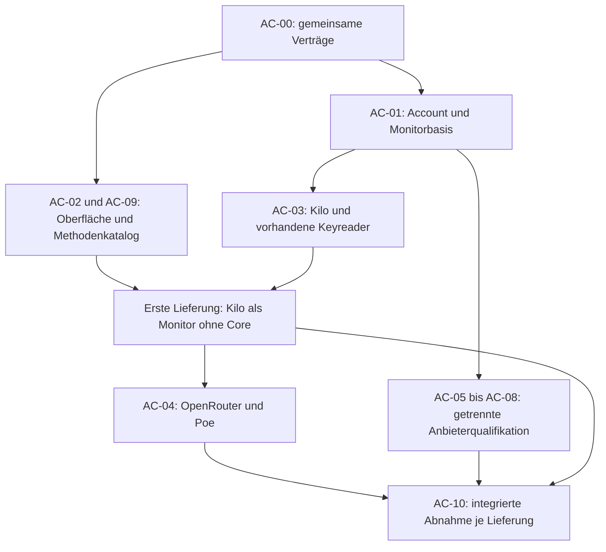

# Account Connect: Arbeitsaufteilung und Übergabe

Stand 24.10.2026, Ausgangscode `5dc916fcea702f2a196520903937570745e26dac`.
Auftrag dieser Runde: aus dem [Account-Connect-Entwurf](../account-connect-redesign-2026-10-24.md)
konkrete Arbeitspakete bilden. Sechs Sol-Worker haben Fachpakete ausgearbeitet;
eine Astra-Gegenprüfung ergänzt Abnahme und Lieferung. **Planungsstand, keine
ausgeführte Implementierung, Registrierung oder Installation.**

## Ergebnis und Reichweite

Der gewünschte Ablauf lautet: **Anbieter wählen → passenden Zugang verbinden →
Kontingente sehen → optional Modelle einrichten.** Ein neuer Account benötigt
keine Modellroute und keinen künstlichen Tarif. Vorhandene Keys bleiben nutzbar;
wo ein belegter Login einen Key liefert, entfällt dessen manuelles Kopieren.
Ein eigenständiger Monitor funktioniert ohne installierten oder laufenden Core.

Bestätigte Anforderungen aus dem Projekt und dem Nutzerauftrag:

- Accounts bleiben der Einstieg, mit kurzen Namen und erhaltbaren eigenen Namen.
- Bestehende Account-IDs, Routen, Profile, Credentials und Historie erhalten;
  Inferenz- und Monitorzugang gehören zum selben fachlichen Account.
- Kontingente und Resets zuerst. Unbekannt bleibt unbekannt; Balance, Ausgaben,
  Ratenlimits und Abokontingente werden nicht zusammengerechnet.
- Einrichtung vereinfachen, Browserlogin bevorzugen, sofern er das ermöglicht.
  Kein zusätzlicher Key, wenn derselbe Zugang die nötigen Reads bereits erlaubt.
- Keine Käufe, automatischen kostenpflichtigen Fallbacks oder Inferenztests
  als versteckte Nebenwirkung des Verbindens oder Aktualisierens.
- Externe OAuth-Snapshots bleiben ohne Refresh/Revoke; der alte Proxy und seine
  Dateien bleiben unberührt. GUI-Abnahmen ausschließlich auf privatem Xvfb.

Maßgebliche Quellen: [Produktumfang](../product-scope.md),
[Monitorziel](../monitor-mode.md), [bestehende API-Verträge](../service-contracts.md),
[Entwurf](../account-connect-redesign-2026-10-24.md) und die dort verlinkten
25 Anbieterberichte. Die konkrete Modulform, Betriebsmodusdarstellung und
Reihenfolge unten sind Empfehlungen dieses Plans. Vor Umsetzung gemeinsamer
Teile werden sie in AC-00 konkretisiert; anbieterbezogene Owner-/Transportfragen
haben ausdrücklich eigene Qualifikationsschritte.

Der anschließende Nutzerauftrag bereitet zusätzlich ein
[screenshotgestütztes UX-Review](../ux-review-2026-10-24.md) und
[UX-Pilot-Entwürfe](../uxpilot-codex-handoff-2026-10-24.md) vor. Diese sind Input
für AC-02, keine stillschweigend festgeschriebene neue Gesamtoberfläche.
Die Backend-/Readerpakete bleiben davon unabhängig planbar; konkrete neue
Navigations- und Detailmuster erst anhand der Designentwürfe übernehmen.

Nicht enthalten sind neue Anbieter außerhalb der 25 recherchierten Anschlüsse,
ein Proxyupgrade, automatische Modelloptimierung, neue Requesthistorie aus
Quotadifferenzen oder ein allgemeiner Browser-Cookiescanner. Zusätzliche
Modelle werden nicht durch einen erfolgreichen Login automatisch freigeschaltet.

## Pakete

| ID | Prüffähiges Ergebnis | Abhängigkeit | Reife und Umfang |
| --- | --- | --- | --- |
| [AC-00](00-integration-contracts.md) | Gemeinsame Verträge, Register und integrierter Host können Monitor und Gateway unterscheiden | Baseline prüfen | Lokaler Vorlauf; Vertragsbeispiele vor paralleler Fachimplementierung festschreiben |
| [AC-01](01-account-foundation.md) | Account ohne Route/Inferenzkey, sichere Reconnect-/Credentialoperationen und Host ohne Core | AC-00 | Lokal implementierbare Basis nach Vertragsfestlegung; neue Providerowner separat |
| [AC-02](02-experience-and-capabilities.md) | Derselbe kurze Connectablauf in Desktop und CLI, bestehende Accounts ergänzen statt duplizieren | AC-00/01; Kilo für ersten Durchstich | UI-/CLI-Fixtures vorher möglich, echte Speicherung erst auf Basisvertrag |
| [AC-03](03-readers-and-public-login.md) | Kilo-Wallet/Pass und belegte Verbesserungen vorhandener Keyreader | AC-00/01; Darstellung AC-02 | Parser lokal planbar; genaue Quellen-/Scopequalifikation bleibt pro Reader sichtbar |
| [AC-04](03-readers-and-public-login.md) | OpenRouter/Poe mit Browserlogin ohne Keykopieren | AC-00/01/02; AC-09 | Öffentliche Flows belegt; Produktionsclient/Callback und durchgängige Abnahme je Methode |
| [AC-05](05-cli-connections.md) | Requesty, Alibaba, Command Code, Fireworks, Mistral über gezielte CLI-Übergaben | AC-00/01/02; AC-09 | Fünf getrennte Qualifikationen, kein pauschaler Cacheimport |
| [AC-06](06-cloud-oauth.md) | Google-Projektmonitor und Cloudflare-Accountmonitor, optional OAuth-Inferenz | AC-00/01/02; AC-09 | Datenquelle, Rechte und Transport jeweils qualifizieren; Monitoring kann früher liefern |
| [AC-07](07-managed-logins.md) | Kimi/Z.ai-Login und unabhängiger Codex-Monitor mit eindeutigem Credentialowner | AC-00/01/02; AC-09 | Bestehende Wege erhalten; Ownerentscheidung und Herstellerintegration separat prüfen |
| [AC-08](08-console-connections.md) | Eigene Consolesitzung liefert gebundene Usage; MiMo zuerst, dann SambaNova/Upstage/Cohere | AC-00/01/02; AC-09 | Zunächst begrenzter Erkenntnisversuch, Browserbrücke noch keine festgelegte Architektur |
| [AC-09](02-experience-and-capabilities.md) | Alle 25 Anbieter mit echten Methoden, Fähigkeiten und verständlichen Fallbacks | AC-00; Ergebnisse AC-03–08 | Basiskatalog sofort planbar; neue Methode erst nach eigener Qualifikation anbieten |
| [AC-10](10-verification-delivery.md) | Unabhängige Abnahme, getrennte Pakete und erhaltene Bestandsinstallation | Je Lieferumfang die betroffenen Pakete | Fixtures vorher, integrierte Abnahme/Installation anschließend; keine vorweggenommene Livefreigabe |

Die [Anbietermatrix](provider-map.md) ordnet jeden der 25 Anbieter genau einem
verantwortlichen Connectpaket zu; zusätzliche Quota-/Fallbackarbeit ist gesondert
benannt. Bestehende Reader werden nicht als neue Arbeit nochmals implementiert.

## Reihenfolge mit frühem nutzbarem Ergebnis

1. **Vorlauf:** Arbeitskopie und Quellenpins prüfen, AC-00-Vertragsbeispiele
   abgleichen. AC-02/09 entwerfen Fixtures; Anbieterworker präzisieren ihre
   eigenen Qualifikationsfälle. Unbelegte Produktionsmethoden noch nicht anbieten.
2. **Erste Lieferung:** AC-01 + Kilo aus AC-03 + AC-02/09 + AC-10. Ein bestehender
   Kilo-Key zeigt USD-Guthaben und passende Passdaten ohne Free-Tariffeld, Route
   oder Core. Ein vorhandenes Gateway bleibt unverändert nutzbar. Diese kleine
   Lieferung beweist die gemeinsame Basis, ohne auf alle Logins warten zu müssen.
3. **Browserdurchstich:** OpenRouter und Poe einzeln freigeben. Poe darf bei
   fehlender Produktionsregistrierung offen bleiben, während OpenRouter liefert.
4. **Weitere Wege:** Requesty vor schwierigeren CLI-Caches; Googlemonitor vor
   OAuth-Inferenz; Kimi/Z.ai und Cloudflare jeweils nach Quellen-/Ownernachweis.
   AC-08 zuerst nur MiMo qualifizieren, bevor eine allgemeine Sessionlösung entsteht.
5. **Pro Lieferung:** vollständige lokale Abnahme, privates Paket, Installation
   im beauftragten Umfang, anschließend gesondert ausgewiesene reale Prüfung.

Anbieterqualifikation darf parallel zu AC-01 als begrenzter Versuch vorbereitet
werden. Sie verleiht noch keine produktive Methode und darf keine eigenen
konkurrierenden Account-/Secret-/Callbackverwaltungen etablieren. Ein offener
Anbieter blockiert nur seine Methode. Die Gesamtabdeckung des Katalogs verlangt
auch ehrliche Fallbacks, nicht erfundene OAuth- oder Quotafunktionen.

## Vorgeschlagene parallele Besetzung

Maximal zwölf gleichzeitig aktive Agenten einschließlich Integrator. Elf Rollen
reichen hier; sie müssen nicht alle von Beginn an laufen. Modelle sind eine
Einsatzempfehlung, kein Projektbenchmark.

| Worker | Modell / Reasoning | Exklusive Verantwortung |
| --- | --- | --- |
| W0 | Astra xhigh | AC-00, gemeinsame DTOs, Registry, Program.cs, zentrale Persistenzmigrationen, Zusammenführung |
| W1 | Astra xhigh | AC-01, Account-/Credential-/Login-Lifecycle, Quotaresolver und Cachegeneration |
| W2 | Sol high | AC-02 und AC-09, Desktop/CLI/Client, gemeinsame UI-Ressourcen, alle Catalog-JSONs |
| W3 | Sol high | AC-03, neue Keyreader und Änderungen vorhandener Reader; Kilo zuerst |
| W4 | Sol high | AC-04, methodenspezifische OpenRouter-/Poe-Loginadapter |
| W5 | Sol high | AC-05, CLI-Adapter und deren private Prozessprotokolle |
| W6 | Astra high | AC-06, Google/Cloudflare, Quotasemantik und jeweiliger OAuthtransport |
| W7 | Sol high | AC-07, neue Kimi-/Z.ai-/Codex-Owneradapter |
| W8 | Sol high | AC-08, begrenzte Sessionconnectorversuche |
| W9 | Astra high | AC-10, unabhängige integrierte Abnahme und Gegenprüfung |
| W10 | Sol medium | AC-10, Paketierung/Installer/Dokumentation; neue Builds mit W0 koordinieren |

**Dateigrenzen:** Paketdateien sind maßgeblich. W0 besitzt `src/Lain.Core/*`,
`src/Lain.Host/Program.cs`, `ProviderCatalogRegistry.cs`, `QuotaContracts.cs`,
`src/Lain.Client/ClientContracts.cs`, gemeinsame Builddateien
und sämtliche Schema-/Migrationsänderungen. W1 besitzt gemeinsame Account-,
Credential-, Operation- und Quotaauflösung; W2 alle Katalogdateien und geteilte
Oberflächendateien einschließlich `src/Lain.Cli/Program.cs` und der Clientwrapper.
Providerworker ändern eigene Adapter/Tests und liefern
Vertrags-, Katalog- und Wiringwünsche an den Eigentümer. W10 darf ausschließlich
die mit W0 übergebenen Auslieferungsskripte verändern. W9 schreibt neue
Abnahmefixtures/-skripte/-evidence, keine Produktfixes an fremden Dateien.

Bei späterer Umsetzung: sauberer gemeinsamer Ausgangscommit, pro Worker eigener
Worktree, kleine isolierte Commits und fortlaufende Integration. Fremde laufende
Änderungen an `docs/product-scope.md`, `docs/provider-*-2026-10-24.md` und
`docs/provider-work-packages/` bleiben erhalten. Es gibt für diesen Plan keinen
aktuellen Commit-/Pushauftrag. Vor einem frischen Checkout müssen die neuen
Plan- und Recherchedateien explizit mitgegeben werden; sie sind derzeit unversioniert.

Builds, Publishes, Installationen und echte Laufzeitprüfungen werden zentral
koordiniert; synthetische Tests bekommen eigenes `LAIN_HOME` und eigenes Xvfb.
Providerkeys gehören weder in Fixtures, Ausgaben noch Commits. Normale Codex-
Konfiguration und Legacyproxy sind keine Testumgebung für diese Arbeit.

## Offene Entscheidungen und Delegationsgrenzen

| Punkt | Empfehlung / nächste Klärung | Blockiert |
| --- | --- | --- |
| Sichtbarer Betriebsmodus | Monitor/Gateway unabhängig von Barebones/Simple/Advanced; Bestand behält Gateway; neuer Monitor kann ohne Core starten | AC-00/01-Modusvertrag, nicht vorhandene Readerparser |
| Mehrdatei-Persistenz | Private unveränderliche Credentialgeneration, dann atomarer Accountverweis; Recovery und Altformat lesen in AC-00/01 konkretisieren | Persistenzänderung vor ihrer Integration |
| Methodenstatus | Anbieterquellenbeleg, lokale Implementierung, lokale Prüfung, Paketfreigabe und reale Accountprüfung getrennt führen | Katalogfreigabe pro Methode |
| Kimi/Z.ai/Codex-Owner | Eigener oder isoliert delegierter Owner nach kleinstem Versuch; niemals denselben rotierenden Grant doppelt besitzen | Je neue Loginmethode, nicht bestehende Key-/Snapshotwege |
| Consolebrowser | AC-08 klärt eine Linux-taugliche eigene Sessionbrücke; keine WebView-Abhängigkeit vor Ergebnis festschreiben | Sessionmethoden |
| Google/Cloudflare-Inferenz | Exakten Transport und Tokenprojektion prüfen; unabhängigen Monitor früher liefern | OAuth-Inferenz, nicht qualifizierte Monitorreads |

Gewöhnliche Datei-, Klassen- und Testdetails sind innerhalb der Grenzen
delegierbar. Neue Rechteausweitungen, neue Refreshowner, veränderte
Kosten-/Routinggarantien oder fremde Credentialübernahme sind keine stillen
Implementierungsdetails. Fehlende Anbieterzulassung oder widersprüchliche
Quellen führen zu einem benannten offenen Teilpaket mit funktionierendem Fallback.

## Übergabe an eine spätere Implementierung

Der ausführende Agent beginnt mit diesem Dokument und AC-00, gleicht den
aktuellen Commit ab und erhält bereits erledigte Arbeit. Er startet die
unabhängigen Pakete nach den Dateigrenzen, friert gemeinsame Vertragsbeispiele
vor der Fachintegration ein und liefert die erste Monitor-/Kilo-Strecke vollständig.
Weitere Anbieter folgen nach ihren eigenen Gates. Keine Methode wird allein
deshalb als verfügbar markiert, weil dieser Plan ihren Zielablauf beschreibt.

Fertig ist eine Lieferung erst nach der ihr zugeordneten AC-10-Abnahme. Ein
Recherchebeleg ist kein Test; ein lokaler Fake ist keine Liveprüfung; ein gebautes
Paket ist keine Installation. Der Abschlussbericht benennt jeweils erreichten
Stand, erhaltenen Bestand und tatsächlich offene Anbieterwege.
