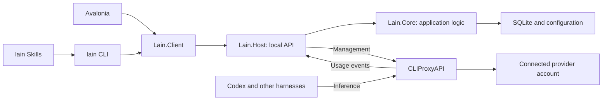

# Architecture and active expansion

Architecture baseline of 23 October 2026 for the
[work packages](implementation-plan.md). The structure below was adopted as
the implementation baseline. Current implementation and evidence are in the
[README](../README.md) and [acceptance record](acceptance.md); historical
recommendations are not additional acceptance claims.

On 24 October 2026, the user also approved a direct CLIProxyAPI upgrade, using
external software with as few changes as possible while retaining Lain's
guarantees. The new build uses v8.0.41 as a verified external dependency and a
separate lain adapter. Necessary SDK extensions remain visible as explicitly
hashed patch files; the previous complete source import is removed. The official
binary alone lacks synchronous journal and binding hooks. The
[upgrade acceptance](core-v8-upgrade.md) distinguishes source evidence, synthetic
qualification, and installed operation. The C# Host structure and HTTP/journal
contracts remain intact.

On 24 October 2026, autonomous
[expansion for Inspector, analysis, and providers](expansion-2026-10-24.md)
was commissioned. Its current scope and implementation/evidence boundaries are
below. The 23 October baseline remains the foundation; its exclusions at that
time are not new restrictions on the expansion task.

## Confirmed scope

- Avalonia UI for usage and administration.
- The first usable state includes a **Lain-managed proxy, account management,
  and persistent usage together**.
- Background operation independent of the open window; skills remain accessible.
- Accept Linux first; account for Windows/macOS in interfaces and operating adapters.
- First real access: Codex/ChatGPT subscription and Command Code.
- Multiple accounts, model menus, and profiles remain core goals. Existing proxy
  software handles inference; new custom provider transports are not desired.

Basis: [product goals](product-scope.md), [inventory](technical-inventory.md),
[proxy review](proxy-backend.md), [harness integrations](harnesses.md).

## Recommendation: shared core behind a local service

Arrows describe responsibilities and data flow. Concrete C# project names and
internal adapter boundaries are delegable details.

| Component | Responsibility |
| --- | --- |
| `Lain.Core` | UI-independent concepts and use cases for accounts, model routes, profiles, usage, and quota; rules and validation |
| `Lain.Host` | Executable .NET background service; local API, collector, persistence/proxy/quota adapters, migrations, and process management |
| `Lain.Client` | Shared typed local API access, version detection, and error handling; no second usage calculation |
| `Lain.Desktop` | Avalonia application: setup, overviews, and interaction |
| `Lain.Cli` | The same use cases as commands and machine-readable JSON; access for skills and scripts |
| CLIProxyAPI | Independent, tested Core for authentication, provider transport, protocol translation, and streams |

A library alone has no lifecycle: it runs only within a process. The Host therefore
owns durable work. UI and CLI directly open neither the product database nor
Core management access. Skills do not load .NET DLLs; initially they use the CLI.
A later MCP adapter uses the same use cases without a second business-logic layer.

.NET 10 is recommended; SDK `10.0.111` is locally available. A compatible stable
Avalonia version is selected during setup. Existing Python serves as a domain
reference and fixture source; an additional Python product runtime is not
currently needed.

## Operation and ownership

The Host runs per local user. On Linux, a systemd user service is the recommended
first integration. Closing the window stops neither Host nor proxy. Login
startup is part of installation integration; operation after complete logout is
not required and does not enable automatic systemd lingering. Paths, service
installation, and secret storage remain replaceable operating adapters.

The managed proxy uses its own ports, configuration, and auth/data paths. The
existing personal proxy is neither taken over nor tapped by a second collector.
Version, SHA-256, license, and configuration state are recorded together.
Updates/switching back must account for both binary and data format.

Confirmed operating boundary: development and parallel installation change
neither the personal proxy's binary/plugins, configuration, auth files, nor
service. Its collector, database, and consuming queue also remain independent.
Test installations use separate service names; client tests use isolated settings
rather than rewriting existing Codex/OpenCode defaults. A port conflict produces
an error or selection of a free test port, never termination of another process.
Test cleanup affects only its own resources.

Development and fault tests initially use local fake upstreams. Real provider
probes use separately configured access/auth storage; existing OAuth refresh
tokens are not copied, rotated, or revoked. Actual provider/session behavior must
be checked for separate logins. Even separate keys may share quotas and rate
limits for the same account; local isolation does not guarantee independent
usage. Load/failure simulation therefore runs locally, not against everyday access.

Recommended client connection: local HTTP API bound only to loopback with a
user-bound access token. Host address and token reference are managed once;
CLI, GUI, and later MCP share discovery. Tokens, proxy credentials, and account
keys belong neither in exported profiles nor logs or normal API responses.
Linux storage must be restricted to the user; concrete storage/credential
mechanics are documented in package B.

There is one responsible consumer per usage source. The Host owns writes and
migrations. GUI and CLI may edit accounts/models concurrently; revisions detect
stale changes rather than overwriting newer settings.

## Contract boundaries

The [shared contracts](service-contracts.md) define domain identities, usage
semantics, and UI/CLI use cases. The wire format is concretely versioned after
package A. A proxy index or model alias is not a stable account ID. Quota and
observed usage remain separate data sources.

The largest technical risk is the source of individual execution attempts,
account attribution, and sufficient delivery quality. Package A must qualify
a concrete Core build and integration. Native queue, small Go SDK launcher,
and existing observer remain alternatives until then. A universal framework
for arbitrary proxy engines is outside the initial scope.

A thin Go launcher still reuses the proxy Core. It is justified only if the
existing management/event interface lacks required facts. Linux-specific
Inspector plugins are not required for basic statistics.

## Extensions and maturity

Account, route, and profile identities should support later role rules,
classifiers, research, and approvers. Configurable conditions reference freely
selectable routes; GLM, Kimi, and Command Code access are interchangeable data.
A custom scheduler, semantic redirection of all requests, and automatic quota
optimization remain outside the current task. Inspector was excluded from the
original baseline and has been an active project since the explicit expansion
task of 24 October.

Confirmed product decisions are clear enough for targeted backend evidence A.
This proposal specifies the shared .NET structure; B–E depend on A's documented
result and adoption of this structure as the implementation baseline. Open wire
fields are delegable; lost account identity or a different durable runtime stack
are not silent implementation details.

## Active expansion of 24 October 2026

Integrated source extends the existing Host/Core split. The
[observability contracts](observability-contracts.md) are the shared domain
boundary; the [independent review](expansion-review.md) records concrete evidence
and remaining limitations. Existing code or a prepared test does not replace
an executed check of the exact build.

| Path | Implemented responsibility | Evidence boundary |
| --- | --- | --- |
| Durable usage | Lain's Go Core adds verified dimensions and actual completion to the journal; Host additively migrates SQLite and computes complete filtered aggregates with sample counts. | Existing journal identity, replay, migration, and new measurements must be checked together for the new Core. No cost values without measurement/pricing sources. |
| Live content | A separate volatile Core ring and Host ring supply bounded, redacted observations; Host translates source generations and cursors. | Core and Host lifetimes differ. Gaps and unknown completions remain visible; no payload archive in SQLite. Details: [Inspector](inspector-design.md). |
| Grouping | Requests and attempts have Core identities; conversation, turn, worker, and tool continuation come only from allowed explicit sources with provenance. | Similar text, times, or model names do not prove relationships. Protocol fixtures qualify only actually tested provenance fields. |
| Providers | Fifteen declarative provider descriptions list sources, setup, budget types, protocols, and concrete route capabilities. Account creation and runtime compilation share configuration/transport validation. | Prepared adapter, successful mock, and real connection are separate states. Missing keys do not block documentation or mocks. [Transport boundaries](providers/transport-qualification.md). |
| UI and CLI | Both read the same Host contracts for analysis, Inspector, and providers. UI formats aggregates and shows only verified groups. | Native presentation, focus, polling, and installed state need separate private-Xvfb evidence; API tests do not prove them. |

Provider expansion continues to use existing Core transports. The declarative
catalog is not a dynamic plugin-code loader and starts no second inference
service in the Host. Private credentials remain behind the account/transport
boundary. Non-secret settings such as region, workspace, account ID, and required
explicit privacy consent are validated; a catalog description does not replace
required setup. Prepared OAuth helpers do not yet imply active login/refresh
lifecycles outside existing qualified login paths.

`free_only` is rejected in the Host and at Core startup until concrete upstream
cost enforcement is qualified. Neither a free label nor unknown-price fallbacks
can authorize paid execution. This is implemented safe refusal, not yet a usable
free dispatch path. Explicit fallback graphs can be validated; execution is also
rejected without a qualified Core contract. UI, CLI, and acceptance must not
present this limitation as working automatic free routing.

The [repeatable expansion verification](verify-expansion.md) runs .NET checks
serially and optional synthetic Host/Core probes in isolated Linux network
namespaces. GUI verification remains a separate private Xvfb run. Passing partial
checks apply to their own source/binary state; they authorize neither automatic
installation nor blanket approval of new providers or the entire expansion.
