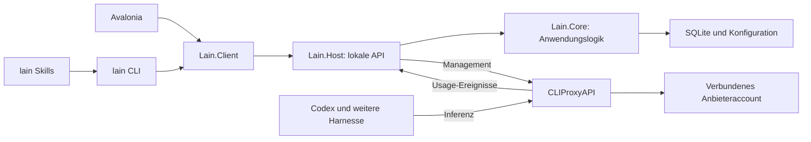

# Architektur und aktive Erweiterung

Architekturgrundlage vom 23.10.2026 für die [Arbeitspakete](implementation-plan.md).
Die folgende Struktur wurde als Implementierungsgrundlage übernommen. Aktuelle
Implementierung und Nachweise stehen in [README](../README.md) und
[Abnahme](acceptance.md); historische Empfehlungen sind keine zusätzlichen
Abnahmebehauptungen.

Am 24.10.2026 wurde die autonome
[Erweiterung um Inspector, Auswertungen und Anbieter](expansion-2026-10-24.md)
beauftragt. Ihr aktueller Zuschnitt und die Abgrenzung zwischen Implementierung
und Nachweis stehen unten. Der Basisstand vom 23.10. bleibt als Grundlage
erhalten; dessen damalige Ausschlüsse werden nicht als neue Einschränkungen
dieses Auftrags gelesen.

## Bestätigter Zuschnitt

- Avalonia-Oberfläche für Usage und Verwaltung.
- Erster benutzbarer Stand enthält einen **von lain verwalteten Proxy,
  Accountverwaltung und persistente Usage gemeinsam**.
- Hintergrundbetrieb unabhängig vom geöffneten Fenster; Skills bleiben erreichbar.
- Linux zuerst abnehmen, Windows/macOS in Schnittstellen und Betriebsadaptern beachten.
- Erste echte Zugänge: Codex-/ChatGPT-Abo und Command Code.
- Mehrere Accounts, Modellmenüs und Profile bleiben Kernziele. Bestehende
  Proxysoftware übernimmt die Inferenz; eigene Providertransporte sind keine
  gewünschte Neuentwicklung.

Grundlage: [Produktziele](product-scope.md), [Bestand](technical-inventory.md),
[Proxy-Prüfung](proxy-backend.md), [Harness-Anschlüsse](harnesses.md).

## Empfehlung: gemeinsamer Kern hinter einem lokalen Dienst

Die Pfeile beschreiben Zuständigkeiten und Datenflüsse. Die konkreten C#-
Projektnamen und die Aufteilung interner Adapter sind delegierbare Details.

| Baustein | Verantwortung |
| --- | --- |
| `Lain.Core` | UI-unabhängige Begriffe und Anwendungsfälle für Accounts, Modellrouten, Profile, Usage und Quota; Regeln und Validierung |
| `Lain.Host` | Ausführbarer .NET-Hintergrunddienst; lokale API, Collector, Persistenz-/Proxy-/Quotaadapter, Migrationen und Prozessverwaltung |
| `Lain.Client` | Gemeinsamer typisierter Zugriff auf die lokale API, Versionserkennung und Fehlerbehandlung; keine zweite Usage-Berechnung |
| `Lain.Desktop` | Avalonia-Anwendung: Einrichtung, Übersichten und Interaktion |
| `Lain.Cli` | Dieselben Anwendungsfälle als Befehle und maschinenlesbares JSON; Zugang für Skills und Skripte |
| CLIProxyAPI | Eigenständiger, getesteter Core für Authverfahren, Providertransport, Protokollübersetzung und Streams |

Eine Bibliothek allein hat keinen Lebenszyklus: Sie läuft erst in einem Prozess.
Deshalb besitzt der Host die dauerhafte Arbeit. UI und CLI öffnen weder die
Produktdatenbank noch den Core-Managementzugang direkt. Skills laden keine .NET-
DLL; sie verwenden zunächst die CLI. Ein späterer MCP-Adapter verwendet dieselben
Anwendungsfälle und eröffnet keine zweite Geschäftslogik.

Empfohlen ist .NET 10; das SDK `10.0.111` ist lokal vorhanden. Die konkrete
Avalonia-Version wird bei Einrichtung auf eine kompatible stabile Version
festgelegt. Bestehendes Python dient als fachliche Referenz und Fixturequelle;
eine zusätzliche Python-Produktlaufzeit wird derzeit nicht benötigt.

## Betrieb und Zuständigkeit

Der Host läuft pro lokalem Benutzer. Für Linux ist ein systemd-User-Dienst die
empfohlene erste Integration. Fenster schließen beendet weder Host noch Proxy.
Autostart nach Anmeldung ist Teil der Installation; Betrieb nach vollständigem
Logout ist nicht gefordert und aktiviert kein automatisches systemd-Lingering.
Pfade, Dienstinstallation und Secretablage bleiben austauschbare Betriebsadapter.

Der verwaltete Proxy verwendet eigene Ports, Konfiguration und Auth-/Datenpfade.
Der vorhandene persönliche Proxy wird weder übernommen noch von einem zweiten
Collector angezapft. Version, SHA-256, Lizenz und Konfigurationsstand werden
zusammen festgehalten. Update/Rückwechsel muss Binary und Datenformat berücksichtigen.

Bestätigte Betriebsgrenze: Entwicklung und parallele Installation verändern weder
Binary/Plugins noch Konfiguration, Authdateien oder Dienst des persönlichen
Proxys. Auch dessen Collector, Datenbank und entnehmende Queue bleiben unabhängig.
Testinstallationen verwenden eigene Dienstnamen; Clienttests erhalten isolierte
Einstellungen statt die bestehenden Codex-/OpenCode-Defaults umzuschreiben.
Ein Portkonflikt erzeugt einen Fehler bzw. eine freie Testportwahl, niemals das
Beenden eines fremden Prozesses. Test-Cleanup betrifft nur eigene Ressourcen.

Entwicklung und Fehlertests verwenden zunächst lokale Fake-Upstreams. Echte
Providerproben nutzen separat eingerichtete Zugänge/Authablagen; bestehende
OAuth-Refresh-Tokens werden nicht kopiert, rotiert oder widerrufen. Für getrennte
Logins ist das tatsächliche Anbieter-/Sessionverhalten zu prüfen. Auch bei
getrennten Schlüsseln teilen dieselben Accounts gegebenenfalls Kontingente und
Rate-Limits; lokale Isolation garantiert hier keine unabhängige Nutzung.
Last-/Fehlersimulation erfolgt deshalb lokal, nicht gegen den Alltagszugang.

Empfohlene Clientverbindung: lokale HTTP-API ausschließlich auf Loopback mit
benutzergebundenem Zugangstoken. Hostadresse und Tokenreferenz werden einmal
verwaltet; CLI, GUI und später MCP verwenden denselben Discoveryweg. Tokens,
Proxycredentials und Accountschlüssel gehören weder in exportierte Profile noch
in Logs oder normale API-Antworten. Die Linux-Ablage muss auf den Benutzer
beschränkt sein; konkrete Ablage-/Credentialmechanik wird in Paket B dokumentiert.

Es gibt einen verantwortlichen Consumer pro Usagequelle. Der Host übernimmt
Schreibzugriffe und Migrationen. Accounts/Modelle dürfen gleichzeitig aus GUI
und CLI bearbeitet werden; überholte Änderungen werden anhand einer Revision
erkannt, statt neuere Einstellungen zu überschreiben.

## Vertragsgrenzen

Die [gemeinsamen Verträge](service-contracts.md) legen fachliche Identitäten,
Usage-Semantik und die Anwendungsfälle für UI/CLI fest. Das Wireformat wird nach
Paket A versioniert konkretisiert. Ein Proxyindex oder Modellalias ist keine
stabile Account-ID. Quota und beobachtete Usage bleiben getrennte Datenquellen.

Das größte technische Risiko ist die Quelle für einzelne Ausführungsversuche
samt Accountzuordnung und ausreichender Zustellqualität. Paket A muss einen
konkreten Core-Build und Anschluss qualifizieren. Native Queue, kleiner Go-
SDK-Launcher und vorhandener Observer bleiben bis dahin Alternativen. Ein
universelles Framework für beliebige Proxyengines ist nicht Teil des Starts.

Ein dünner Go-Launcher wäre weiterhin Wiederverwendung des Proxy-Cores. Er ist
nur begründet, wenn die vorhandene Management-/Ereignisschnittstelle die nötigen
Fakten nicht liefert. Linux-spezifische Inspektorplugins sind keine Voraussetzung
für die grundlegende Statistik.

## Erweiterungen und Reife

Account-, Route- und Profilidentitäten sollen spätere Rollenregeln, Classifier,
Research und Approver wiederverwenden. Konfigurierbare Bedingungen verweisen auf
frei wählbare Routen; GLM, Kimi und Command-Code-Zugänge sind austauschbare Daten.
Ein eigener Scheduler, semantische Umleitung aller Requests und automatische
Kontingentoptimierung bleiben außerhalb des aktuellen Auftrags. Der Inspector
war im ursprünglichen Grundumfang nicht enthalten und ist seit dem ausdrücklichen
Erweiterungsauftrag vom 24.10. ein aktives Vorhaben.

Die bestätigten Produktentscheidungen sind klar genug für den gezielten
Backendnachweis A. Dieser Vorschlag konkretisiert die gemeinsame .NET-Struktur;
B–E hängen vom dokumentierten Ergebnis aus A und der Übernahme dieser Struktur
als Umsetzungsgrundlage ab. Offene Wirefelder sind delegierbar; verlorene
Accountidentität oder ein anderer dauerhafter Laufzeitstack sind keine stillen
Implementierungsdetails.

## Aktive Erweiterung vom 24.10.2026

Der integrierte Quellstand ergänzt die bestehende Host-/Core-Aufteilung. Die
[Observability-Verträge](observability-contracts.md) sind die gemeinsame
fachliche Grenze; die [unabhängige Gegenprüfung](expansion-review.md) führt
konkrete Nachweise und verbleibende Einschränkungen. Vorhandener Code oder ein
vorbereiteter Test ersetzt keine ausgeführte Prüfung des exakten Builds.

| Pfad | Implementierte Zuständigkeit | Nachweisgrenze |
| --- | --- | --- |
| Dauerhafte Usage | Der eigene Go-Core ergänzt belegte Dimensionen und tatsächlichen Abschluss im Journal; der Host migriert SQLite additiv und berechnet vollständige gefilterte Aggregate mit Stichprobenzahlen. | Bestehende Journalidentität, Replay, Migration und neue Messungen müssen gemeinsam für den neuen Core geprüft werden. Keine Kostenwerte ohne Mess-/Preisquelle. |
| Laufende Inhalte | Ein eigener flüchtiger Core-Ring und ein separater Host-Ring liefern begrenzte, redigierte Beobachtungen; der Host übersetzt Quellgenerationen und Cursor. | Core- und Host-Lebensdauer sind verschieden. Lücken und unbekannte Abschlüsse bleiben sichtbar; kein Payloadarchiv in SQLite. Details und Grenzen: [Inspector](inspector-design.md). |
| Gruppierung | Request und Versuch besitzen Core-Identitäten; Gespräch, Turn, Worker und Toolfortsetzung stammen nur aus erlaubten expliziten Quellen mit Provenienz. | Ähnliche Texte, Zeiten oder Modellnamen beweisen keine Beziehung. Protokollfixtures qualifizieren nur die tatsächlich geprüften Herkunftsfelder. |
| Anbieter | Fünfzehn deklarative Anbieterbeschreibungen führen Quellen, Einrichtung, Budgetarten, Protokolle und Fähigkeiten konkreter Routen. Accountanlage und Runtimekompilierung verwenden gemeinsame Konfigurations-/Transportvalidierung. | Vorbereiteter Adapter, erfolgreicher Mock und echte Verbindung sind getrennte Zustände. Fehlende Keys blockieren Dokumentation und Mocks nicht. [Transportgrenzen](providers/transport-qualification.md). |
| Oberfläche und CLI | Beide lesen dieselben Hostverträge für Analyse, Inspector und Anbieter. UI formatiert die Aggregate und stellt nur belegte Gruppen dar. | Native Darstellung, Fokus, Polling und installierter Zustand benötigen eigene private-Xvfb-Nachweise; ein API-Test belegt sie nicht. |

Die Anbietererweiterung verwendet weiter die vorhandenen Core-Transporte. Der
deklarative Katalog ist kein dynamischer Plugincode-Loader und eröffnet keinen
zweiten Inferenzdienst im Host. Private Credentials bleiben hinter der
Account-/Transportgrenze. Nicht geheime Einstellungen wie Region, Workspace,
Account-ID oder notwendige ausdrückliche Datenschutzfreigaben werden validiert;
eine Katalogbeschreibung ersetzt keine erforderliche Einrichtung. Vorbereitete
OAuth-Helfer bedeuten außerhalb der vorhandenen qualifizierten Loginpfade noch
keinen aktiven Login-/Refresh-Lebenszyklus.

`free_only` wird derzeit im Host und beim Core-Start abgewiesen, solange die
konkrete vorgelagerte Kostenkontrolle nicht qualifiziert ist. Damit können weder
ein Gratislabel noch unbekannt bepreiste Fallbacks bezahlte Ausführung erlauben.
Das ist eine umgesetzte sichere Ablehnung, noch kein nutzbarer kostenloser
Dispatchpfad. Explizite Fallbackgraphen können geprüft werden; ihre Ausführung
wird ohne qualifizierten Core-Vertrag ebenfalls abgewiesen. Diese Einschränkung
darf in Oberfläche, CLI oder Abnahme nicht als funktionierendes automatisches
Gratisrouting dargestellt werden.

[Der wiederholbare Erweiterungsprüflauf](verify-expansion.md) führt .NET-Prüfungen
seriell und optionale synthetische Host-/Core-Proben in isolierten Linux-
Netzwerknamespaces aus. GUI-Prüfungen bleiben ein eigener privater Xvfb-Lauf.
Erfolgreiche Teilprüfungen gelten jeweils für ihren Quell-/Binarystand; sie
autorisieren keine automatische Installation und keine allgemeine Freigabe
neuer Provider oder der gesamten Erweiterung.
