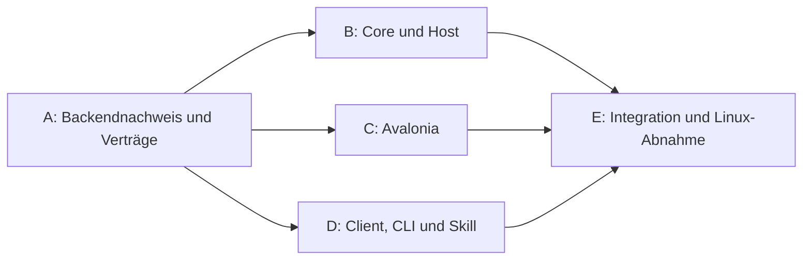

# Arbeitspakete für den ersten benutzbaren Stand

Stand 23.10.2026. **Planungsstand, kein laufender Implementierungsauftrag.**
Im Repository liegen bisher Dokumente, keine Produktimplementierung; `main`
hat noch keinen Commit und keinen Remote. Die Pakete beziehen sich auf lain,
nicht auf den bestehenden persönlichen Proxy-/TUI-Stack.

## Ziel und Grundlage

Der erste benutzbare Stand betreibt einen eigenen lokalen Proxy, verwaltet
Accounts und zeigt deren persistente Usage in Avalonia. Der Dienst arbeitet bei
geschlossenem Fenster weiter; CLI und Skills greifen auf dieselben Funktionen zu.
Linux ist die erste abgenommene Plattform. Echte Referenzzugänge sind ein
Codex-/ChatGPT-Abo und Command Code. Eine bloße Anzeige des bisherigen Python-
Backends erfüllt diesen gewählten Umfang nicht.

Maßgeblich: [Produktziele](product-scope.md), [Architekturvorschlag](architecture.md),
[fachliche Verträge](service-contracts.md), [Proxybestand](proxy-backend.md),
[Harnessmatrix](harnesses.md). Implementierungsbasis ist der vorgeschlagene
.NET-Kern mit eigenständigem Host, Clientbibliothek, Avalonia und CLI.

**Reife:** A ist als begrenzter technischer Nachweis konkret zugeschnitten.
B–E sind in Ergebnis, Zuständigkeit und Abnahme vorbereitet; sie werden nach A
mit gewähltem Core, Eventformat und API-Beispielen zur ausführbaren Übergabe
vervollständigt. Die gemeinsame .NET-Struktur ist die begründete Empfehlung.
Eine andere dauerhafte Laufzeit oder ein anderer Prozessbesitz ist eine sichtbare
Architekturänderung, kein stiller Implementierungsspielraum.

## A – Eigenen Proxy samt Account- und Usage-Vertrag qualifizieren

**Ergebnis:** Ein isolierter, reproduzierbarer Datenpfad belegt, welcher konkrete
Core-Build wie verwaltet wird und wie sein tatsächlicher Verbrauch dauerhaft
einem lain-Account zugeordnet werden kann. Das ist noch kein Produktrelease.

1. Reproduzierbaren Core-/Fixturestand im Projekt verfügbar machen, mit Quelle,
   Lizenz, Build-/Artefakthash und Konfigurationsversion. Der vorhandene gepatchte
   v7-Build ist belegt; v8.0.40 ist ein unqualifizierter Kandidat. Eine Auswahl
   benötigt die folgenden Nachweise, nicht bloß einen erfolgreichen Start.
2. Eigenes temporäres Konfigurations-/Auth-/Datenverzeichnis und eigene Ports
   verwenden. Bereitschaft erst nach registrierten Accounts und Modellen prüfen.
   Start, Neustart, Fehlkonfiguration und Wiederherstellung untersuchen.
   Die [Isolationsgrenze](architecture.md#betrieb-und-zuständigkeit) gilt für
   alle Pakete: eigene Binärdatei/Dienstnamen und Testclientkonfiguration; keine
   Änderung oder Neustart des vorhandenen Proxys/Collectors. Konflikte stoppen
   nur den Test, Cleanup entfernt nur eigens angelegte Ressourcen.
3. Zwei verschiedene synthetische Credentials desselben Providers mit gleichem
   Modellalias anbinden. Accountidentität je Versuch, Rename/Keywechsel und
   Entfernen/Wiederanlegen nachvollziehen. Ein Coreindex bleibt adapterintern.
4. Queue, SDK-Sink oder bestehenden Observer auf die benötigten Fakten prüfen;
   den kleinsten ausreichenden Anschluss auswählen. Replay/Deduplizierung,
   Schreibfehler, Collector-Ausfall und Shutdown prüfen. Verlustfenster festhalten.
   Im normalen reproduzierbaren Ablauf müssen alle erwarteten Requests/Versuche
   und ihre gemeldete Usage vollständig ankommen. Für Ausfälle Verlust- und
   Erkennungsgrenzen konkret nachweisen; deren bloße Dokumentation ist noch
   keine Zustimmung zu einem beliebig verlustbehafteten Produktbetrieb.
5. Nonstream, SSE, Toolaufruf samt Toolergebnis, Abbruch und einen synthetischen
   429/Retry abdecken. WebSocket nur zusätzlich, wenn der erste Clientanschluss
   es tatsächlich verwendet. Striktes Account-Pinning und bewusste Poolauswahl
   getrennt prüfen; ein SDK-Pin beweist keinen beliebigen HTTP-Pin-Vertrag.
6. Danach mit den beiden gewählten echten Zugängen minimale Anschlussproben
   durchführen: eigener OAuth-Login und Command-Code-Key, jeweils eine kurze
   Streaming- und Toolfortsetzungsprobe mit dem benannten Protokoll und einem
   harmlosen Testtool. Bekannte relevante Toolschema-Anpassungen berücksichtigen;
   ein erfolgreicher Textrequest allein qualifiziert die Providerübersetzung
   nicht. Echte Credentialrotation/OAuth-Erneuerung nur bei tatsächlichem
   Nachweis als getestet ausweisen; synthetische und reale Belege unterscheiden.
   Login/Authablage separat einrichten; bestehende Refresh-Tokens nicht kopieren
   oder erneuern. Vorab den belegten Session-/Kontingentscope festhalten. Live-
   Proben auf demselben Anbieteraccount teilen dessen Limits; sie dürfen nicht
   als vollständig unabhängiger Testbetrieb bezeichnet werden. Solange geeignete
   Zugänge fehlen, bleibt die reale Providerabnahme offen; die synthetischen
   Teile können unabhängig abgeschlossen werden.

**Abnahme:** Ein Request mit mehreren Versuchen ist korrekt getrennt; jeder
Versuch ist einem Account zugeordnet. Wiederholte Ereignisse zählen nicht doppelt.
Ein strikt gewählter Account wird bei 429/Deaktivierung nicht unbemerkt ersetzt.
Persistierte Ereignisse bleiben nach Neustart erhalten; nicht rekonstruierbare
Lücken sind ausgewiesen. Zwei Aliasnamen desselben Credentials sind kein
Mehraccountnachweis. Die vorhandene Produktionsqueue wird nicht konsumiert.
Vor/nach den Tests prüfen, dass der bestehende Dienst nicht ersetzt/neugestartet
und seine Konfiguration/Authablage nicht durch den Test verändert wurde. Eigene
Prozesse/Ports und der begrenzte Cleanup müssen im Testaufbau nachvollziehbar sein.

**Abgabe:** `docs/backend-qualification.md`, versioniertes Artefaktmanifest,
bereinigte Ereignis-/Erwartungsfixtures, ein erneut ausführbarer isolierter
Nachweis und die konkretisierten gemeinsamen Verträge. Fehlende Request-/Versuchs-
oder Accountzuordnung bedeutet: A ist nicht bestanden; Architektur/Anschluss
nacharbeiten, bevor abhängige Implementierung freigegeben wird.
Ist die Providerübersetzung noch ungeprüft oder die Tragbarkeit eines gemessenen
Verlustverhaltens offen, bleibt die betreffende Anschlussentscheidung offen.
Der Bericht benennt dann den nötigen Nachweis bzw. die nötige Produktentscheidung,
statt A automatisch als bestanden zu markieren.

Nützliche lokale Quellen aus `codex-proxy-tui`:
`integrations/model-usage/EVENTS.md`,
`integrations/model-usage/scripts/integration_test.py`,
`integrations/model-usage/scripts/websocket_integration_test.py`,
Store-/Query-Regressionstests und `integrations/proxy-core/baseline.json`.
Diese Quellen sind Referenzen, kein automatisch gültiger lain-Vertrag. A übernimmt
benötigte bereinigte Fixtures samt Provenienz ins Projekt, damit die weitere
Übergabe nicht von persönlichen Home-Pfaden abhängt. Toolschema-Prüfer mit echten
Anbieteraufrufen nicht ungeprüft als Offline-Fixtures behandeln.

## B – Hintergrunddienst mit Accounts und persistenter Usage

**Voraussetzung:** A bestanden und gewählter Management-/Eventvertrag festgehalten.
**Zuständigkeit:** Core, Host, Datenbank und Betriebs-/Provideradapter.

- .NET-Host unabhängig von Avalonia starten; lokale API, Bereitschaft und
  benutzergebundenen Clientzugang bereitstellen. Genau eine Instanz besitzt
  Proxykonfiguration, Collector und Migrationen.
- Gewählten Core als eigenen Prozess verwalten. Accounts hinzufügen, Login
  begleiten, prüfen, deaktivieren und entfernen; Historie und Secrets getrennt
  behandeln. Gewünschten und wirksamen Konfigurationsstand darstellen.
- Ereignisse normalisieren und speichern; stabile Account-/Routezuordnung,
  Request-/Versuchstrennung und Aggregation gemäß Vertrag umsetzen.
- Quotaquellen für Codex und Command Code als Accountinstanzen anbinden, mit
  Quellenzeit, Fehlern und letztem Erfolg. Fehlende Restwerte als unbekannt zeigen.
- Modelle/Routen und ein einfaches benanntes Profil bereitstellen; noch keine
  automatische Optimierung oder inhaltliche Klassifikation von Requests.

**Abnahme:** Beide Zugangstypen können eingerichtet werden; zwei synthetische
Accounts desselben Providers bleiben getrennt. Requests über den eigenen Proxy
erscheinen nach Neustart in der API mit korrekter Zuordnung. Ein Quotaabruf kann
scheitern, ohne andere Accounts auszublenden. Gleichzeitige Konfigurationsänderungen
erkennen Revisionkonflikte. Stoppen/Starten des Fensters ist für den Dienst irrelevant.

## C – Avalonia: Einrichten, Accounts und Usage benutzen

**Voraussetzung:** API-Beispiele/Typen nach A; für Live-Abnahme zusätzlich B.
**Zuständigkeit:** Desktop-Oberfläche und Viewmodels; gemeinsame Clientbibliothek
verwenden. Parallelentwicklung mit klar gekennzeichneten Vertragsfixtures ist möglich.

- Einrichtung des eigenen Diensts/Proxys verständlich führen und Zustand zeigen.
- Accountliste mit mehreren Accounts pro Anbieter, Login-/Fehlerzuständen und
  lesbaren Kontingenten; Modelle und einfaches Profil auswählen.
- Usageübersicht mit Zeitraum, Tagesverlauf, Modell-/Accountaufteilung und
  Requests/Fehlern; Filter für interessante Fehler wie 429.
- Aktualisierung, Datenalter, unbekannte Werte und unvollständige Abdeckung
  sichtbar machen. Timing-/Durchsatzkennzahlen nur bei belegter Datengrundlage.
- Ruhige, lesbare Gestaltung mit zurückhaltenden Lain-/Wired-Anklängen;
  keine rohen JSON-Objekte als normale Account- oder Usageansicht.

**Abnahme:** Einrichtung und die wichtigsten Ansichten funktionieren klickbar ohne
KI. Die Summen entsprechen dem Host. Fenster schließen, weiterarbeiten und neu
öffnen zeigt zusätzliche Usage. Fehler/Recovery und mehrere Accounts bleiben
verständlich; Fixture-/Demodaten werden nicht als echte Nutzung dargestellt.

## D – Gemeinsamer Clientzugang, Harness und erster Skill

**Voraussetzung:** gemeinsame API-Verträge nach A; Integration benötigt B.
**Zuständigkeit:** Clientbibliothek, CLI, erster Harnessadapter und Usage-Skill.

- Typisierten API-Client für Desktop und CLI bereitstellen. CLI bietet Status,
  Accounts, Profile und Usage als stabile JSON-Ausgabe mit dokumentierten Fehlern.
- Vorschlag für den ersten Referenz-Harness: Codex CLI. Ein einfaches Modellprofil
  in dessen Konfiguration/Modellmenü überführen, vorhandene Einstellungen erhalten
  und den tatsächlichen Clientbuild benennen. Weitere Harnesse bleiben über
  denselben Adaptervertrag anschließbar.
- Einen kleinen `lain:usage`-Skill an den echten CLI-Vertrag anbinden. Der Skill
  erklärt gemessene Werte samt Quellzeit; er liest keine Datenbankdateien selbst.
- Profil speichern/exportieren mit Accountplatzhaltern; Syntax des Skillnamens
  und Registrierung anhand des Zielclients prüfen.

**Abnahme:** Gleicher Zeitraum/Datenstand liefert in GUI und CLI dieselben Werte.
Eine frische Sitzung des Referenzclients sieht die freigegebenen Modelle und
arbeitet über den eigenen Proxy. Der Skill kann bei geschlossener GUI antworten.
Ein nicht laufender Host erzeugt eine verständliche Diagnose und keinen zweiten
Collector. Ein Profilexport enthält keine Zugangsdaten oder Nutzungshistorie.

## E – Linux-Paket und gemeinsame Abnahme

**Voraussetzung:** B, C und D integriert. Erst jetzt entsteht der ausgewählte
erste benutzbare Stand aus Proxy, Accounts und Usage zusammen.

- Installation/Start für einen Linux-Benutzer aus einem frischen Produktverzeichnis;
  Startbefehl ist unabhängig vom aktuellen Arbeitsverzeichnis.
- Eigene Dienst-, Port- und Datenpfade; Autostart nach Anmeldung und kontrolliertes
  Beenden/Neustarten. Bestehender persönlicher Proxy bleibt unabhängig nutzbar.
- Beide echten Zugänge einrichten, ein Modellprofil im Referenzclient verwenden,
  Usage und vorhandene Quota in GUI/CLI/Skill nachvollziehen.
- Neustart, Proxyfehler, ungültige Credentials und Wiederherstellung prüfen.
  Binary-/Konfigurationsrückwechsel und tatsächliche Grenzen dokumentieren.
- Laufzeit-/Lizenzmanifest und kurze Betriebsanleitung mit Start, Status,
  Datenablage und Deinstallation liefern; Windows/macOS-Abnahme folgt später.

**Abnahme:** Der durchgängige Ablauf funktioniert aus einer frischen Installation,
Usage läuft bei geschlossenem Fenster weiter und persistiert über Dienstneustarts.
Es gibt keine Doppelzählung und keine als vollständig ausgegebenen bekannten
Erfassungslücken. Alle angebotenen Account-/Modellzustände stammen aus dem echten
verwalteten Dienst; der Skillszugang nutzt denselben Stand.

## Abhängigkeiten und parallele Arbeit

C und D können nach gemeinsamem Vertrag parallel zu B arbeiten; der minimale
Client aus D wird früh geteilt. Ein Verantwortlicher integriert Vertragsänderungen.
Aufgaben bekommen eindeutige Dateizuständigkeiten; Integration ist eine eigene
Arbeit und keine automatische Folge mehrerer fertiger Teilbranches.

## Nachgelagert und verbleibender Spielraum

Eigene Rollen, allgemeine Bedingungen → Routen und konfigurierbarer Classifier
sind gewünschte Erweiterungen. Approver-Anschlüsse, Research, größere
Skillbibliothek, weitere Harness-Wizards, Quotaoptimierung und Inspektor werden
nach dem ersten gemeinsamen Stand gesondert geschnitten. Ihre benötigten
Account-/Route-/Profilidentitäten sind im Kern bereits berücksichtigt.

Ordnerstruktur, konkrete UI-Komponenten, Testframework und interne Klassennamen
sind delegierbar. Core-Version/Ereignisquelle entscheidet A anhand der Abnahme.
Eine zweite komplette Proxyimplementierung, Ersatz durch einen reinen Viewer,
unklare Accountzuordnung oder eine nur bei offener GUI laufende Erfassung würden
den bestätigten Zuschnitt ändern und erfordern eine sichtbare Neuplanung.
