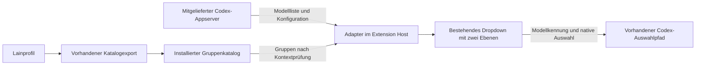

# Modellgruppen in Codex für VS Code

Stand 26.10.2026. **Umsetzung durch „gut implementiere“ beauftragt.** Ziel ist
die gruppierte Modellauswahl im bestehenden Codex-Dropdown innerhalb von VS Code.
AP1–AP5 sind umgesetzt und vor lokaler Bereitstellung isoliert qualifiziert.
Ein laufendes Produktionsfenster wird nicht automatisch neu geladen.
Tatsächlicher Lieferstand und Belege: [Lieferbericht](vscode-model-groups-delivery-2026-10-26.md).
Lokale Variante 26.1021.22028 installiert, Aktivierung nach Nutzerreload offen.

## Ergebnis und erster Umfang

Auf dem vorhandenen Linuxrechner öffnet der Nutzer die Codex-Modellauswahl,
wählt beispielsweise eine vorhandene Gruppe wie Free oder IT Sec und darin ein
Modell. Gruppen, Reihenfolge, Mehrfachmitgliedschaften und optionale Gruppenrouter
stammen aus demselben installierten Lain-Katalog wie im Terminal. Die Auswahl
verwendet die tatsächliche Modellkennung und den vorhandenen Codex-Auswahlpfad.

Empfohlene erste Liefergrenze: lokale VS-Code-Erweiterung, bestehender Lainzugang,
zwei Menüebenen im selben Dropdown. Die erste Ebene zeigt Gruppen, die zweite
deren Modelle mit Zurück-Navigation. Eine Gruppe zu öffnen ändert das Modell
noch nicht. Remote SSH, WSL, Dev Containers und andere Editoren folgen erst nach
eigener Qualifikation. Ihr bisheriger Betrieb muss unverändert weiter möglich sein.

Das Vorhaben ergänzt eine Clientdarstellung. Es enthält keinen neuen Scheduler,
keine Workerautomatik, keinen Profilapply und keine Änderung an Providerzugängen.
Es ist unabhängig von der noch nicht installierten Worker-Host-/CLI-Lieferung.

## Geprüfter Ausgangsstand

Arbeitskopie `main`, HEAD `fef478f`, mit umfangreichem bestehendem WIP. Der
Codexlauncher und Workerstand sind im [Lieferbericht](release-workers-2026-10-26.md)
dokumentiert. Vor Umsetzung den dann aktuellen Stand erneut erfassen; diese
Planung hat Produktcode und installierte Erweiterung nicht geändert.

| Bestandteil | Lesend festgestellter Stand |
| --- | --- |
| VS Code | 1.143.1, Commit `e646868227c3e3a9e3f24277c8c7220be42c0be7`, Linux x64, Snap-Launcher |
| Codex-Erweiterung | `openai.chatgpt`, Version `26.1021.22027`, installiertes Linux-x64-Paket |
| Mitgelieferte Binary | `codex-cli 0.164.0-alpha.11.1`, SHA256 `e6d386e8822288f6d5f327e966a5a5e1de928de8795bb6149716005a410f38f2` |
| Terminalclient | Separat qualifizierte gepatchte Version 0.164.0; nicht dieselben Bytes wie die Erweiterungsbinary |
| Extension Host | `out/extension.js`: eigener Requestverteiler, `config/read`, `model/list` und Zugriff auf die effektive Konfiguration vorhanden |
| Weboberfläche | `model-picker-options-2e5c9d5f09f6.js` erzeugt einzelne Modelloptionen; `access-row-56c64d268a49.js` rendert die Optionsliste |
| Gruppendaten | Kein `lain_model_picker`-Lesepfad in den untersuchten installierten JavaScriptdateien |
| Bearbeitungsbasis | Gebündeltes JavaScript ohne mitgelieferte Source Maps; kein nachgewiesener reproduzierbarer Sourcebuild der VS-Code-Oberfläche |

Die Release-0.164.0-Protokollquellen liefern `model/list` mit Modellen und
Pagination, ohne Lain-Gruppen. `model/list` hat dort keinen `cwd`-Parameter,
`config/read` dagegen schon. **Diese Releasequellen sind kein Nachweis des
exakten Alpha-Protokolls der Erweiterung.** Die unterschiedliche Kontextauflösung
ist ein konkreter Prüfpunkt für AP1, insbesondere bei Projektüberschreibungen.

Die offizielle Dokumentation bestätigt gemeinsame Konfigurationsschichten für
CLI und IDE. Sie beschreibt `chatgpt.cliExecutable` als Entwicklungseinstellung,
deren manuelle Änderung Teile der Erweiterung beeinträchtigen kann:
[Config basics](https://learn.chatgpt.com/docs/config-file/config-basic),
[Developer settings](https://learn.chatgpt.com/docs/developer-settings?surface=ide).
Das ist kein dokumentierter Schalter für unsere Gruppendarstellung.

## Empfohlene technische Richtung

Ein kleiner Adapter im Extension Host liest ausschließlich die Gruppendarstellung
aus dem bereits installierten Katalog. Die vorhandene Binary bleibt zunächst
erhalten. Die Weboberfläche erhält nur validierte Gruppen und ihren geprüften
Kontext. Für die Modellauswahl verwendet sie die vorhandenen Callbacks samt
Reasoning- und Threadverhalten. Kein neuer Inferenzweg und kein direkter
Lain-HTTP-Aufruf aus der Weboberfläche.

Die Wiederverwendung betrifft den bestehenden Vertrag `lain_model_picker` mit
`schema_version = 1`, nicht einen zweiten Modellbestand. Gruppierung ersetzt
weder native Modellverfügbarkeit noch native Reasoningoptionen. Es werden keine
Modelle durch Namenspräfixe, Anbieterheuristiken oder manuelle Zweitlisten gruppiert.

**Tragende Annahme:** Der Extension Host kann für den tatsächlich verwendeten
Appserver eine übereinstimmende Provider-/Katalogbindung nachweisen und den
Picker mit dieser Bindung versorgen. Ein beliebiges `config/read(cwd)` plus eine
globale Modellliste genügt dafür nicht. Falls diese Zuordnung mit der Alpha-Binary
nicht möglich ist, muss AP1 eine andere Datenanbindung zur Entscheidung vorlegen.
Ein zusätzlich gepatchter Appserver wäre dann eine eigene Erweiterung des Plans.

Der Adapter liest nur zulässige, benutzereigene Katalogdateien. Die Prüfung
übernimmt dieselben Schema-/Sichtbarkeitsregeln wie die CLI und berücksichtigt
Dateigrößen, Link-/Spezialdateien und Änderungen während des Lesens. Er gibt
keine rohe Konfiguration, Authfelder, Tokens oder beliebige Dateiinhalte an die
Weboberfläche weiter. Der konkrete interne Nachrichtenvertrag wird nach dem
Kontextnachweis in AP1 festgehalten.

## Arbeitspakete und Abhängigkeiten

### AP1 – Durchgängigen Anschluss und Installation nachweisen

In einer isolierten Erweiterungskopie die tatsächlichen Datenpfade vom
Appserver bis zum Dropdown und zurück zur Modellwahl dokumentieren. Das
Alpha-Protokoll, die effektive Provider-/Katalogbindung sowie die vorhandenen
Modell-/Reasoning-Callbacks prüfen. Einen synthetischen Katalog mit überlappenden
Gruppen und unterschiedlichen Modellkennungen verwenden; keine echte Inferenz.

Zusätzlich die Aktivierung einer lokal angepassten Erweiterung über den normalen
VS-Code-Erweiterungsmechanismus prüfen: Zustand erhalten, genau eine aktive
Codex-Erweiterung, vollständige Paketressourcen, klare Variantenkennzeichnung
und Rücknahme auf das Original. Der Snap-Launcher und die tatsächliche Webview-CSP
gehören in den Nachweis. Keine laufende Produktionsinstallation patchen.

**Fertig, wenn:** ein nachvollziehbarer Durchstich Gruppenmetadaten am richtigen
Pickerkontext zeigt, eine native Modellwahl mit synthetischen Daten erhalten
bleibt und ein belastbarer Installations-/Rücknahmeweg demonstriert ist.
Andernfalls benennt AP1 konkret, welche der vorgeschlagenen Schnittstellen oder
Lieferannahmen nicht trägt. AP2–AP4 erhalten daraus ihren gemeinsamen Vertrag.

### AP2 – Gruppen sicher an die Oberfläche anbinden

Den Adapter als eigenen kleinen Quellbaustein im Projekt pflegen. Er löst den
aktuellen Katalog über die nachgewiesene Backendbindung auf, validiert dessen
Gruppen und verbindet sie mit der vollständigen nativen Modellliste einschließlich
Pagination. Nur native auswählbare Modelle erscheinen auswählbar.

Kontextwechsel zwischen Projekt, Verbindung oder Konfiguration verwerfen alte
Ergebnisse. Eine verspätete Antwort darf keine Gruppen aus dem vorigen Kontext
anzeigen. Gruppierung wird nur für einen nachgewiesenen Lainkontext aktiviert;
abweichende Provider und explizite andere Profile folgen der bestehenden Auswahl.
Wo die konkrete Erweiterung keinen Profilnachweis liefert, wird kein Profil aus
Dateinamen oder globalen Einstellungen geraten.

**Fertig, wenn:** gültige Gruppen exakt zum wirksamen Kontext passen;
unlesbare/ungültige Gruppen oder nicht nachweisbare Bindungen lassen die native
Liste mit kurzem Hinweis nutzbar. Native Konfigurations-/Modelllistenfehler bleiben
sichtbar. Es gibt keinen automatischen Provider-, Modell- oder Profilwechsel.

### AP3 – Gruppen im vorhandenen Dropdown bedienen

Den bestehenden Picker um die vorgeschlagenen zwei Ebenen erweitern. Gruppen
und Modelle bleiben mit Maus und Tastatur bedienbar; Escape kehrt aus der
Modellliste zur Gruppenliste zurück. Fokus, aktuelles Modell, Scrollposition und
schmale Seitenleisten werden berücksichtigt. Modelle dürfen mehreren Gruppen
angehören; Alle enthält jedes sichtbare Modell einmal.

Eine vorhandene Gruppenrouterkennung wird über den nativen Auswahlpfad angeboten.
Fehlt der Router, bleibt Automatisch deaktiviert. Keine Route wird durch Öffnen
einer Gruppe aktiviert. Versteckte oder nativ gesperrte Modelle werden durch
Gruppendaten nicht freigeschaltet. Reasoningwerte werden weiterhin nativ geprüft;
das Menü erfindet kein pauschales `none` und ändert keinen Wert bloß beim Öffnen.

**Fertig, wenn:** sichtbare Auswahl, tatsächliche Modellkennung und gespeicherter
Zustand übereinstimmen, einschließlich Gruppenüberschneidung, Router, fehlendem
Router, nativen Sperren und passendem Reasoning. Wechsel bestehender Threads
verwendet exakt den vorhandenen Mechanismus; neue Gruppen versprechen keine
zusätzliche Modellwechselkompatibilität.

### AP4 – Versionierten Patch und Wartung liefern

Empfehlung ist ein begrenzter Patch für einen ausdrücklich qualifizierten
Erweiterungsbuild. Eigene Adapterquellen und Transformationen bleiben im
Lainprojekt; fremde vollständige Bundles werden dafür nicht als eigener Sourcefork
ins Repository kopiert. Relevante Eingabedateien, Binary und Ausgabepaket werden
mit Hashes und Versionen erfasst. Änderungen an minifiziertem, teils durch den
React-Compiler erzeugtem Code benötigen exakte Strukturprüfungen und integrierte
Tests; ein unspezifisches Suchen/Ersetzen ist keine tragfähige Lieferbasis.

Bereitstellen, Prüfen, Aktivieren, Status und Rücknahme bleiben unterscheidbar.
Vor Aktivierung steht eine vollständige geprüfte Kandidatenkopie bereit. Keine
Mischung aus alter Hostlogik und neuem Frontend während einer laufenden Sitzung.
Die konkrete Aktivierung folgt dem Nachweis aus AP1; ein Fensterreload wird nicht
still ausgelöst. Konfiguration, Credentials, Extensionzustand und andere
VS-Code-Erweiterungen bleiben erhalten.

Ein unbekanntes Erweiterungsupdate wird nicht blind gepatcht. Das unveränderte
Original darf dann weiterlaufen; der Lainstatus benennt den fehlenden
Gruppensupport dieser Version. Ein neuer Build benötigt eigene Qualifikation.
Der Patch trägt seine Herkunft als lokale Lainanpassung und wird nicht als
offiziell signiertes OpenAI-Paket ausgegeben. Öffentliche Paketverteilung ist
eine eigene Lieferentscheidung; das installierte LICENSE verweist auf OpenAI-
Nutzungsbedingungen und belegt keine frei verfügbare Sourcefork-Lizenz.

**Fertig, wenn:** Kandidat, installierte Variante und unverändertes Original
unterscheidbar sind, Rücknahme funktioniert und ein unbekanntes Update weder
überschrieben noch fälschlich als gruppenfähig ausgewiesen wird.

### AP5 – Native Abnahme und lokale Bereitstellung

Die exakten Paketbytes mit VS Code Extension Host und echter Weboberfläche in
privater Umgebung prüfen. GUI nur privates Xvfb; Konfiguration und Provider sind
synthetisch. Der originale HOME-Pfad bleibt erhalten und wird privat gemountet;
HOME/CODEX_HOME werden nicht umbelegt. Eine bestandene CLI-, DOM- oder Mockprüfung
allein ist keine Abnahme des Dropdowns.

Abnahmematrix:

- Lainstandard: Gruppen öffnen, Modell wählen, neue Sitzung behält die Wahl.
- Andere Provider und unterstützte abweichende Profile: native Darstellung bleibt.
- Mehrfachmitgliedschaft, Alle, Unicode, verborgene Modelle, fehlender Router.
- Ungültige Metadaten, fehlende Datei, geänderte Generation, Timeout und verspätete
  Antwort nach Projekt-/Verbindungswechsel: keine falsche oder veraltete Gruppierung.
- Abweichender Projektprovider/-katalog: kein Vermischen mit der globalen Liste.
- Modellwahl im neuen und bestehenden Thread, jeweilige native Reasoningoptionen;
  bloßes Navigieren schreibt keine Auswahl oder Konfiguration.
- Schmale Seitenleiste, Tastatur/Fokus/Escape, Öffnen/Schließen der Weboberfläche.
- Original → lokale Variante → Original, aktivierte Variante nach Reload,
  unbekanntes Update, erhaltene Konfiguration/Auth-/Extensionzustände.
- Fortlaufende Terminalgruppenprüfung am dort bereits qualifizierten Client.

Vor der tatsächlichen Installation einen konkreten geprüften Kandidaten mit
Wartungsbeleg bereitstellen. Danach den tatsächlichen Installationszustand
prüfen und einen erforderlichen Reload als Aktivierungsschritt kenntlich machen.
Echte Inferenz ist zur Abnahme der Menüdarstellung nicht erforderlich und würde
separat autorisierten Umfang benötigen.

## Parallelisierung und Grenzen der Planreife

AP1 ist der erste Durchstich und liegt auf dem kritischen Pfad. Danach können
AP2, AP3 und AP4 anhand desselben festgehaltenen Vertrags parallel bearbeitet
werden. AP5 integriert sie. Die bestehende Grenze bleibt: höchstens zwölf Agenten,
eine serielle schwere Build-/Runtimelane. Die Umsetzung nutzt getrennte Worker
für Hostadapter, Wartung und native VS-Code-Abnahme; UI und Patchintegration
liegen auf dem Hauptpfad.

Die Empfehlung erfüllt das angenommene Ziel im vorhandenen Dropdown, bezahlt
das aber mit Wartung je gebündelter Erweiterungsversion. Eine eigene ergänzende
VS-Code-Erweiterung wäre bei gescheitertem Patchnachweis neu zu bewerten: Sie
könnte eine eigene Gruppenoberfläche anbieten, ersetzt damit jedoch nicht
automatisch die aktuelle Codex-Modellauswahl. Ein vollständiger UI-Fork und ein
gepatchter Appserver bleiben vorläufige Alternativen mit größerem Lieferumfang.

Keine Pflichtfrage ist offen, um diesen Plan auszuarbeiten. **Noch nicht
nachgewiesen** sind der Alpha-Kontextvertrag und der sichere Installationsweg.
Sie blockieren die Zusage einer fertigen Lieferung, nicht die technische
Untersuchung in AP1. Falls dafür das vorhandene Dropdown aufgegeben oder eine
weitere Binary dauerhaft ersetzt werden müsste, kommt diese Entscheidung zurück
ins Sparring. Der anschließende ausdrückliche Ausführungsauftrag autorisiert
diese Umsetzung.

## Wiederaufnahme und Quellen

Bestätigte Produktziele: [product-scope.md](product-scope.md), insbesondere
Profilgruppen und Mehrharnessanschluss. Bestehende Wartung:
[Codexdispatcher](../clients/codex/dispatcher.md),
[Codexwartung](../clients/codex/maintenance.md). Diese Unterlagen beschreiben
bislang die CLI, nicht bereits einen VS-Code-Patch.

Lokale Bestandsquelle ist das Paket
`~/.vscode/extensions/openai.chatgpt-26.1021.22027-linux-x64/`. Beim Übergeben auf
einen anderen Rechner zuerst dessen Extensionstand erfassen. Identifikationspins
dieses untersuchten Pakets:

- `package.json`: `ea31244803e0f7b70071b1743bdf50fcf197534db032cc0fcbc48347a44de4ed`
- `out/extension.js`: `a9cc6736cd2c2d22f6cf43fc5763d5f8a873e4f741f522b44a600b1926f4e627`
- `webview/assets/model-picker-options-2e5c9d5f09f6.js`:
  `4ed468ee7276465093996f01fe20654a8b0c380ba58843d1052eacc97c7cd47d`
- `webview/assets/access-row-56c64d268a49.js`:
  `ed7d897994129ac9aa1c9c5af316cf12a48c6eab8272bf5395d6ac58610117fb`

Die Pins identifizieren gelesene Ausgangsbytes. Sie sind keine Qualifikation
einer modifizierten Erweiterung, kein vollständiges Paketmanifest und kein
Nachweis der später geplanten Tests.
